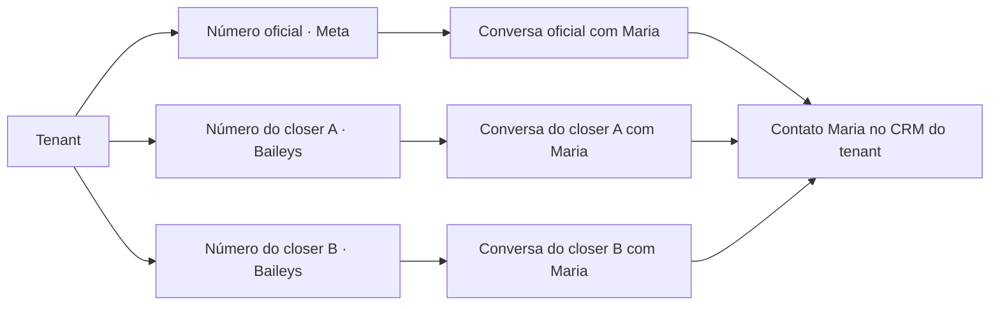

# WhatsApp com múltiplas conexões simultâneas por tenant

Data: 26/10/2026. Estado: arquitetura aprovada e implementação em uso na Tecfag. As seções 10 a 12 registram o escopo entregue e a evolução do controle de acesso e do fluxo de captura.

Contexto operacional atualizado pelo responsável em 26/10/2026: a Valem não está em operação; a Tecfag é o sistema real em https://tecfagchat.up.railway.app/negociacoes/quadro. Não foi informado um ambiente separado de homologação. O piloto real deve preservar os dados e a conexão principal da Tecfag, usar números operacionais escolhidos pelo responsável e evitar cadastros fictícios no banco real.

## 1. Objetivo e decisão principal

Permitir que o mesmo tenant mantenha um número corporativo pela Meta e vários números de vendedores pelo Baileys, simultaneamente. Provedor é uma propriedade da conexão, e deixa de ser uma escolha exclusiva para o tenant.

O cadastro comercial do contato continua compartilhado dentro do tenant. Cada par **conexão da empresa/vendedor + contato do cliente** possui sua própria conversa. A ficha do contato e da negociação pode reunir os históricos autorizados, preservando o número, a origem e a autoria de cada mensagem.

Decisão confirmada na conversa: o chat oferece por padrão a timeline cronológica de todos os números autorizados daquele contato, com identificação da origem de cada mensagem. O envio continua vinculado à conversa selecionada, com indicação junto ao campo de escrita. Trocar o número abre/reutiliza outro atendimento; não altera o remetente do histórico existente. Não há limite de cinco conexões no modelo: a capacidade operacional precisa ser medida no servidor escolhido.

Exemplo: Maria fala com o número oficial e com dois closers. Há um contato Maria, três conexões e três conversas. Uma mesma negociação pode estar vinculada às três conversas, mediante as regras comerciais existentes. Receber outra conversa não cria automaticamente outra negociação nem altera a carteira do contato.

Compartilhar o contato não concede acesso automático a todas as suas conversas. Valem e Tecfag continuam com silos separados, inclusive quando o telefone do cliente é igual.

## 2. O que o código atual permite e o que precisa mudar

| Ponto existente | Evidência no repositório | Mudança necessária |
|---|---|---|
| Escolha exclusiva do provedor | `src/db/schema.ts`: `channelConfigs.activeProvider`; `src/lib/whatsapp/service.ts` | Resolver uma conexão específica para cada atendimento. |
| Uma sessão Baileys por tenant | `src/lib/baileys/session-manager.ts`: mapas e `getSession(tenantId)` | Indexar sockets, QR, mutex, tentativas e estado por tenant e conexão. |
| Uma autenticação Baileys por tenant | `src/lib/baileys/drizzle-auth.ts`: `channelConfigs.baileysAuthKeys` | Persistir credenciais separadas por conexão. |
| Bloqueio de QR quando Meta está ativa | `src/routes/api/baileys/connect.ts` | Validar o provedor da conexão solicitada, sem bloquear as demais. |
| Uma conversa por contato no tenant | `src/db/schema.ts` e migração `0021_conversation_contact_unique.sql` | Unicidade por tenant, conexão e contato para WhatsApp. |
| Credenciais Meta obtidas pelo tenant | `src/lib/whatsapp/adapters/meta.ts` | Obter credenciais e `phone_number_id` da conexão. |
| Envio e recuperação presos ao provedor ativo | `outbound.ts`, `dispatch.ts`, `durable-recovery.ts` | Gravar e preservar a conexão de origem em cada operação. |
| Identificadores externos sem conexão | `types.ts`, `inbound.ts` e `session-manager.ts` | Incluir conexão na identidade dos eventos e mensagens. |
| JID e BSUID diretamente no contato | `src/db/schema.ts`: `contacts.whatsappJid`, `whatsappUserId` | Separar identidades externas do cadastro comercial. |
| Regras de acesso por canal/fila/responsável | `src/lib/access-control/conversation-policy.ts` | Acrescentar autorização sobre a conexão em todos os caminhos de acesso. |

Já existem captura de `messages.upsert`, importação de `messaging-history.set`, sincronização de contatos e tratamento de `fromMe` no Baileys. São componentes reaproveitáveis; sua existência não comprova paridade completa nem cobertura integral de histórico e mídia em vários números.

## 3. Modelo de dados proposto

Nomes abaixo são propostos, ainda não representam tabelas implementadas.

### `whatsapp_connections`

- `id` imutável e `tenantId` obrigatório.
- `provider`: `meta` ou `baileys`, imutável para essa identidade de conexão.
- Nome de apresentação, telefone verificado após conexão e identificadores do provedor.
- `ownerOperatorId` opcional: responsável pela conexão pessoal; separado do responsável pela conversa, da carteira e da negociação.
- Tipo operacional corporativo ou individual, status, último erro e instantes de atividade.
- Referência a credenciais protegidas; versão das credenciais e geração de pareamento.
- Política de importação, histórico, automação, setor e distribuição.

Uma preferência do tenant pode indicar a conexão padrão para NOVAS conversas. Essa preferência não redireciona conversas existentes ou mensagens pendentes. Não fixar provedor por empresa.

Um mesmo número não pode ser pareado inadvertidamente em duas conexões ativas ou em tenants diferentes. Validar isso após identificar o número real, inclusive sob concorrência. O primeiro escopo contempla números distintos. Usar o mesmo número via Meta e Baileys simultaneamente exigiria um projeto específico de coexistência, elegibilidade e deduplicação entre transportes.

### `whatsapp_connection_access`

Relaciona tenant, conexão e operador com direitos explícitos: visualizar, responder e realizar pareamento/reconexão própria. Administração, concessão de acesso e alteração de credenciais corporativas continuam administrativas.

O administrador pode criar a conexão individual e delegar o pareamento ao closer. O closer lê o QR da própria conexão sem receber acesso às credenciais ou às conexões dos colegas. QR deve ter validade curta e só ser entregue aos usuários autorizados.

### `contact_channel_identities`

Relaciona `tenantId`, `connectionId`, `contactId`, tipo e valor do identificador externo, incluindo seu emissor/escopo quando aplicável. Mantém PN, JID, LID, identificadores Meta e evidência de correspondência sem tratá-los como intercambiáveis.

- Unicidade operacional por tenant, conexão, tipo, escopo e valor externo.
- Telefone normalizado confiável pode localizar um contato já existente dentro do tenant, respeitando os guardas atuais e as regras de revisão de duplicidades.
- Não transformar LID ou BSUID em telefone. Não inferir identidade pelo nome, avatar ou semelhança textual.
- Sem correspondência confiável, manter identidade pendente ou contato separado sujeito à revisão; não fundir automaticamente.
- Nomes da agenda de cada vendedor ficam como aliases da conexão. Importar um nome local não sobrescreve o nome comercial validado no CRM.
- Preservar a compatibilidade dos campos legados durante a transição e migrar todos os leitores antes de removê-los.

### Conversas, mensagens e eventos

`conversations` recebe canal próprio e `whatsappConnectionId`. A escolha do transporte não deve depender de `contacts.mainChannel`, porque o contato pode participar de vários canais.

Para o WhatsApp, a chave de conversa passa a ser `(tenantId, whatsappConnectionId, contactId)`. Inicialmente, preservar a continuidade atual de uma conversa por par e registrar ciclos de atendimento nos mecanismos existentes. Site e demais canais conservam sua semântica, com restrições próprias; não aplicar a unicidade de WhatsApp a conexões nulas.

`messages`, `pending_inbounds` e o envelope de saída carregam conexão e contexto externo. Mensagens internas e de sistema têm tratamento explícito e não são despachadas como mensagens de WhatsApp.

- Deduplicação de mensagens: tenant + conexão + ID externo, incluindo peer/direção quando a semântica do provedor exigir.
- Deduplicação de eventos: acrescentar tipo, identidade e versão/estado do evento; uma atualização de status não pode eliminar a atualização seguinte.
- Idempotência de saída: chave validada contra tenant, conversa, conexão e conteúdo original; tentativa divergente retorna conflito.
- Citações, reações, recibos, downloads, presença e retentativas usam a mesma conexão da mensagem/conversa.
- FKs compostas e restrições devem impedir vínculos entre tenants e mensagens cuja conexão diverge da conversa. Consultas continuam filtradas por `tenantId`.

## 4. Regras de operação e experiência

1. O cliente escreve ao número oficial: entra na conversa oficial, com suas regras de fila e triagem.
2. Escreve ao número da equipe: entra na conversa daquele número. Novos atendimentos adicionais aguardam captura explícita; parear o aparelho ou receber mensagens não atribui automaticamente o atendimento ao titular e não altera a carteira comercial.
3. A resposta usa a conexão fixa da conversa. A requisição interna identifica a conversa; o servidor resolve tenant, conexão e destinatário e verifica as permissões.
4. Para iniciar contato por outro número, o operador escolhe uma conexão autorizada e abre/reutiliza a conversa correspondente. O histórico anterior preserva sua origem.
5. Trocar o atendente não troca o número. Outro operador só assume/responde se tiver acesso àquela conexão. Se for preciso usar seu próprio número, abrir outro atendimento vinculado ao contato/negócio.
6. O cabeçalho e a caixa de envio mostram sempre o número de saída e o nome da conexão. A lista oferece filtros por conexão, titular e provedor.
7. A ficha do contato/negócio permite visualizar os históricos autorizados lado a lado ou em uma timeline identificada. A timeline agregada não envia mensagens sem selecionar uma conversa de destino.
8. Uma desconexão do closer não interrompe os demais números. Reconectar o mesmo número recupera a mesma conexão. Parear um número diferente exige outra identidade e não reaproveita a conversa antiga silenciosamente.

Mensagens capturadas com `fromMe` representam uma saída da conta conectada. Registrar a origem como dispositivo vinculado/externo quando não vier do sistema. Não atribuir automaticamente o autor ao titular: o evento pode não identificar a pessoa ou o aparelho que enviou. Não fabricar métricas de produtividade, comissão ou resposta com autoria desconhecida.

A mensagem enviada pelo sistema pode reaparecer no socket. Correlacionar o eco ao envio original para não duplicar registros ou disparar novamente automações. Uma mensagem externa capturada não deve entrar outra vez na fila de envio.

## 5. Redundância, recuperação e regras de cada transporte

Redundância aqui significa preservar dados e contexto comercial, com conexões independentes. Uma mensagem do número A não deve ser retransmitida automaticamente pelo B. Para o cliente, são remetentes diferentes.

- Persistir eventos recebidos antes de processá-los e usar a fila durável de saída existente, acrescida da conexão.
- Isolar fila, reconexão, limites e circuitos de falha por conexão; preservar a ordem por conversa.
- Manter um único processo proprietário de cada socket Baileys por meio de lease distribuído e token de geração, se houver múltiplas instâncias. Um processo antigo não pode salvar chaves após perder a posse.
- Retentativa conserva conexão, destinatário e contexto. Resultado incerto exige reconciliação; não reenviar por outro número para contornar a incerteza. Não prometer entrega exatamente uma vez quando o provedor não oferece essa garantia.
- Janela de atendimento Meta deve ser apurada por conexão e cliente; uma mensagem para o closer não abre a janela do número oficial. Templates continuam vinculados ao contexto Meta/WABA correto.
- Configurar conexões pessoais com automação desativada inicialmente. Ativação posterior exige política por conexão, além dos limites já definidos por tenant, mantendo persona e Vertex AI centralizados.
- Backups precisam incluir dados, mídias e credenciais protegidas, com testes de restauração e sem depender exclusivamente do estado em memória do socket.

Na Meta, validar a assinatura com o segredo da aplicação cadastrada e resolver cada `phone_number_id` para uma conexão registrada. Lotes podem conter vários números; preservar o contexto de cada change e o isolamento de cada tenant. A URL não é autoridade para tenant ou conexão.

## 6. Conta pessoal, sincronização e limites funcionais

O pareamento conecta uma conta do WhatsApp. Não existe classificação confiável que separe automaticamente cliente, familiar e amigo apenas pelo QR ou pelo nome na agenda.

Antes de habilitar captura em números pessoais, definir uma política visível de quais conversas e contatos entram no sistema: conta dedicada à operação, conta integralmente integrada, ou seleção explícita de conversas comerciais. Na opção seletiva, filtrar antes da persistência durável; gravar tudo em logs/eventos brutos e depois esconder na UI não implementa essa política. O processo conectado ainda recebe os eventos da conta.

Sincronizar contatos do WhatsApp para o CRM é diferente de garantir gravação bidirecional na agenda nativa do celular. Essa segunda capacidade precisa de validação específica e não deve ser prometida como efeito automático do QR.

O histórico importável é o que o WhatsApp disponibiliza à sessão, e mídias antigas podem não estar mais disponíveis. A UI precisa distinguir importação inicial, sincronização ao vivo, pendências e falhas. Não prometer recuperação integral do passado.

Baileys é uma integração independente e não oficial. Sua estabilidade e cobertura precisam ser homologadas separadamente da Meta. Montar matriz de paridade para texto, áudio, documentos, imagens, vídeo, citações, reações, edições/exclusões, recibos, presença, contatos e histórico. Onde não houver suporte confirmado, informar a limitação em vez de anunciar equivalência total.

## 7. Migração sem comprometer a operação atual

1. **Inventário em homologação.** Mapear usos de `activeProvider`, `getSession(tenantId)`, `contactId -> conversa`, identidades, mídias, eventos, automações, CRM e métricas. Usar banco e números de teste; este documento não executa o inventário em produção.
2. **Expansão compatível.** Criar tabelas/campos inicialmente opcionais e resolver a conexão legada com compatibilidade ao comportamento atual. Preparar testes e implantação atrás de flag por tenant.
3. **Identidade da conexão atual.** Vincular a configuração existente à conexão correspondente sem logout, limpeza de chaves ou solicitação automática de novo QR. A transferência de posse do socket/chaves precisa ser controlada; não manter dois gerenciadores escrevendo a mesma autenticação.
4. **Tratamento do histórico.** Históricos atuais podem conter mensagens de provedores/números diferentes devido a trocas anteriores. `provider` sozinho não comprova o número usado. Preservar IDs, vínculos comerciais, mensagens e procedência; usar evidências disponíveis ou marcar origem legada desconhecida. Não atribuir todo o passado ao número atualmente conectado. Se a separação exigir novas conversas, manter o histórico legado acessível e um mapa auditável de vínculos, sem mover tarefas/cards em massa por suposição.
5. **Roteamento completo.** Migrar envio, inbound, credenciais, captura do celular, status, presença, mídia, templates, reações, IA, recuperação e todas as rotas legadas. Introduzir autorização por conexão também em SSE/WebSocket, buscas, notificações, exports e análises; filtrar apenas a tela principal é insuficiente.
6. **Novas restrições.** Só substituir a unicidade tenant/contato quando todos os escritores, locks, caches e IDs determinísticos tiverem escopo de conexão. Preservar as regras dos demais canais. Ensaiar impacto de locks/DDL em homologação antes da janela operacional.
7. **Piloto.** Testar Meta + dois Baileys no mesmo tenant de teste e dois tenants separados. Ativar o piloto autorizado na Tecfag por flag e com número operacional escolhido. Não criar contatos reais ou seeds de teste em produção.
8. **Expansão.** Liberar novos closers após validar captura pelo celular, permissões, recuperação e indicadores. Valem permanece com o caminho operacional compatível até uma ativação independente.

Rollback antes da primeira conversa adicional pode voltar ao leitor legado. Depois de haver múltiplas conexões, não retornar a binário que presume uma conversa por contato: desabilitar novas conexões e preservar um leitor compatível com as conversas já criadas. Desativar a flag não apaga registros nem reenvia pendências pelo provedor padrão.

## 8. Critérios de aceite

- Mesmo cliente fala com Meta e dois Baileys: um cadastro comercial quando a identidade é comprovada, três conversas e respostas pelos números corretos.
- Dois vendedores usam nomes de agenda diferentes: sem sobrescrever o cadastro comercial ou gerar fusão por nome.
- Eventos externos com o mesmo ID em conexões diferentes não colidem; repetir o mesmo evento na mesma conexão não duplica mensagens.
- Enviar pelo celular registra uma saída sem eco duplicado e sem atribuir falsamente autoria autenticada.
- Fechar/reabrir uma conversa, mudar carteira ou assumir atendimento não altera as demais conversas do contato.
- Janela Meta, citação, reação, mídia e recibo não usam contexto do outro número.
- Reconectar, reiniciar o servidor e recuperar filas preserva conexão e destinatário. Falha em uma sessão não bloqueia as demais.
- Duas instâncias não operam o mesmo socket nem sobrescrevem suas credenciais simultaneamente.
- Closer pode parear apenas sua conexão delegada. Outro operador não obtém histórico, QR, anexos ou eventos dela por caminhos alternativos.
- Mesmo telefone em tenants diferentes permanece isolado; IDs de conexão/conversa de outro tenant são rejeitados.
- Modo seletivo de captura não persiste conversas excluídas em histórico, eventos brutos, mídias ou logs.
- Histórico legado com origem incerta continua identificado como tal, sem quebra de links, cards e tarefas.
- Nenhum novo caminho liga automaticamente SDR, supervisor ou auditoria em tenant/conexão onde a política não autoriza.

## 9. Referências e decisões de produto ainda abertas

- [Baileys: eventos de mensagens e contatos](https://github.com/WhiskeySockets/baileys.wiki-site/blob/main/docs/socket/receiving-updates.md).
- [Baileys: sincronização e limites de histórico](https://github.com/WhiskeySockets/docs/blob/main/advanced/history-sync.mdx).
- [Baileys: identidades PN/LID e migração v7](https://github.com/WhiskeySockets/docs/blob/main/migration/v7.mdx).
- [Baileys: natureza da integração e manutenção](https://github.com/WhiskeySockets/Baileys).
- Regras comerciais existentes: `docs/customer-identity-consolidation.md` e `docs/PLANO-CONVERSAS-CRM.md`.

Definir antes do piloto: política de captura nos celulares pessoais; quais gestores/colegas acessam cada conexão; responsável substituto quando o titular está ausente; e quais funções da matriz de paridade são obrigatórias no primeiro lançamento. Essas escolhas não impedem preparar o modelo e a compatibilidade em homologação, mas não devem ser presumidas para capturar contas pessoais em produção.

## 10. Implementação local e ativação

O primeiro escopo mantém a conexão principal na configuração existente e adiciona múltiplos números Baileys simultâneos. A principal pode continuar em Meta ou Baileys, conforme a configuração atual. A migração não atribui retrospectivamente um número ao histórico legado, não copia nem apaga as credenciais atuais e não força novo QR da conexão principal.

Implementado:

- Tabelas de conexões adicionais, identidades externas por conexão e seleção de contatos comerciais; índices e restrições no PostgreSQL para separar conversas e impedir vínculos entre tenants.
- Gerenciadores Baileys separados por tenant/conexão, autenticação criptografada, QR com validade e acesso restrito, leases para impedir duas instâncias de possuir a mesma sessão e proteção contra gravações tardias de credenciais.
- Cadastro pelo administrador e pareamento pelo titular; política explícita de captura integral ou somente contatos selecionados. No modo selecionado, abrir um atendimento por esse número autoriza a sincronização daquele contato. Eventos de outros contatos são filtrados antes da persistência durável.
- Rotas de envio, reações, presença, anexos, recuperação e contexto Meta vinculadas ao atendimento. Rotas antigas de envio direto rejeitam uma conversa adicional e orientam o uso da rota universal.
- Captura das mensagens do dispositivo vinculado com autoria autenticada desconhecida, deduplicação dos ecos, identidades sem sobrescrever JID/nome comercial da conexão principal e notificações das novas conversas após commit.
- Histórico unificado paginado e cronológico, com origem identificada, respeitando as permissões de cada conversa. Abrir outro número reutiliza/cria a conversa correspondente no mesmo contato e permite reaproveitar os vínculos comerciais existentes.
- Controles nas configurações e no chat, inclusive na interface que reutiliza `ChatPanel`: conexão/QR, número de saída junto ao compositor, visão de todos os números ou só do atendimento atual e abertura por outra conexão.

O titular e os administradores mantêm o acesso, sujeito às permissões gerais de atendimento. A ampliação descrita na seção 11 permite compartilhar cada número adicional com grupos de acesso, separando leitura e envio. Parear conexões de terceiros exige a permissão administrativa de WhatsApp; compartilhar leitura/envio não concede pareamento. Novas conexões não recebem SDR, supervisor ou respostas automáticas.

Ativação no ambiente disponível:

1. Disponibilizar o código e aplicar a migração registrada `0047_whatsapp_multi_connection` pelo runner `npm run db:migrate:platform`. No Railway atual, esse runner já faz parte de `npm run start`. Conferir projeto, serviço e ambiente antes da publicação; a Tecfag usa dados reais. Manter inicialmente a flag desabilitada e verificar a conclusão da migração e a saúde do serviço.
2. Configurar no servidor `WHATSAPP_CONNECTION_ENCRYPTION_KEY`: chave aleatória de 32 bytes, representada por 64 caracteres hexadecimais. Mantê-la em armazenamento de segredos e no processo de backup; não versioná-la.
3. Configurar `WHATSAPP_MULTI_CONNECTION_TENANTS` com a lista separada por vírgulas dos IDs autorizados. Sem essa configuração, o recurso fica desabilitado. Não usar uma habilitação global para os dois clientes.
4. Como não há homologação separada informada, criar a primeira conexão operacional autorizada, escolher titular e política de captura e parear o número escolhido pelo responsável. No modo selecionado, abrir um atendimento de um contato comercial autorizado para validar a sincronização. Não criar seeds ou contatos fictícios no banco real. Conferir o histórico e o remetente nos celulares envolvidos.
5. Homologar Meta + pelo menos dois Baileys com envio pelo painel e pelo celular, mídia, citações, reações, queda/reconexão, retomada da fila, permissões e limites de histórico. O teste automatizado cobre seis Baileys e uma principal Meta com transportes simulados; não substitui o pareamento real.
6. Expandir aos demais vendedores após concluir o piloto. A liberação inicial deve ser restrita à Tecfag; a Valem permanece inativa até uma liberação própria.

O runtime de referência continua sendo um servidor Node persistente. Leases protegem a posse das sessões entre processos; isso não implementa por si só um barramento distribuído de eventos. O pareamento usa QR protegido no banco, mas uma solicitação de logout direcionada a uma instância que não possui o socket é rejeitada explicitamente. Uma implantação com várias instâncias exige validar o direcionamento do controle das sessões e a distribuição dos eventos em tempo real.

Validação reproduzível: `npm run test:whatsapp-connections` usa PostgreSQL embarcado em memória (PGlite), sem carregar `.env`, sem conectar a banco externo e sem criar sockets reais. Inclui seis números adicionais, conversas independentes, isolamento, ACL, criptografia, leases, pareamento, captura seletiva, deduplicação, roteamento, citações e timeline. Executar também `npm run test:access`, `npm run test:triage` e `npm run build` antes da entrega.

Verificação local de 26/10/2026: build concluído, 16 testes de múltiplas conexões, 187 testes de acesso e 340 testes de triagem aprovados; ESLint dos oito novos arquivos TypeScript/TSX aprovado. O typecheck global ainda acusa erros existentes no projeto e não foi considerado aprovado. Esses testes não homologam sessões reais nem garantem capacidade de produção para seis sockets.

A consulta pública ao health check da Tecfag respondeu HTTP 200. O responsável renovou o login da CLI do Railway. Projeto confirmado: `TecfagChat`, ambiente `production`, serviço `ValemChat`, domínio `tecfagchat.up.railway.app`. A atualização mobile anterior já está publicada e deve ser preservada. Antes desta migração foi criado um backup manual do volume PostgreSQL, confirmado na listagem do Railway em 26/10/2026 às 13:05 UTC (ID `ea9264fe-3ca6-4087-806f-2b4133989d3d`). A verificação direta do banco e o SSH não responderam nesta rede; conferir o resultado da migração pelos logs de inicialização e a disponibilidade pela aplicação. Nenhum cadastro fictício ou sessão real de WhatsApp foi criado para essa validação.

## 11. Permissões de grupos por conexão

Em **Controle de Acesso > Grupos**, o grupo selecionado oferece a seção **Acesso aos números de WhatsApp**, com a lista dos números da equipe. A edição exige papel de administrador, acesso ao módulo de controle de acesso e permissão de criar/editar grupos; não exige permissão de configurar WhatsApp ou de abrir o chat. Cada número tem dois controles: **Visualizar histórico** e **Enviar mensagens**. Ao liberar envio, a interface libera também leitura; ao retirar leitura, retira também envio. Todas as concessões começam desabilitadas e não alteram o titular ou as permissões dos administradores. A conexão principal continua seguindo o RBAC geral já existente. Cadastro, pareamento e desconexão de aparelhos permanecem em Ajustes > WhatsApp.

A migração aditiva `0048_whatsapp_connection_group_access` guarda as concessões por tenant, conexão e grupo. Chaves estrangeiras, trigger de tenant e constraint de envio/leitura protegem os vínculos também no banco. O servidor deriva a associação ao grupo da sessão autenticada; IDs ou permissões fornecidos pelo cliente não concedem autoridade.

Essas concessões se somam às regras de módulo, canal, fila e responsável do grupo. Não ultrapassam uma restrição a atendimentos próprios. Para responder, o operador continua precisando assumir o atendimento e ter as permissões normais de captura ou tomada de controle. Grupos com somente leitura não podem enviar, reagir, iniciar atendimento por aquele número ou assumir/transferir seu atendimento. Transferências verificam também o acesso do destinatário ao número.

O histórico unificado, anexos e eventos usam a mesma condição de leitura no servidor. Revogar a concessão bloqueia novas requisições imediatamente e sinaliza aos membros do grupo conectado que atualizem o contexto de acesso; eventos seguintes são novamente filtrados no banco. Compartilhar leitura/envio nunca concede o QR, logout, criação de números ou administração das permissões.

Os testes embarcados executam as duas migrações em PostgreSQL de teste, validam grupos entre tenants, acesso por número, leitura sem envio, revogação, preservação de titular/admin, API administrativa e bloqueio de envio, reação e captura antes de efeitos operacionais. Nenhuma concessão a grupos reais é criada pela migração ou pelos testes.

A alteração de localização preserva as concessões existentes e não precisa de nova migração. A rota interna `/api/groups/whatsapp-connections` valida tenant e permissões do administrador, detecta edição desatualizada e grava concessão e auditoria na mesma transação. A antiga ação de compartilhar no endpoint de conexões não realiza mais alterações e orienta a usar o Controle de Acesso. O painel de Ajustes não oferece mais controles de compartilhamento.

## 12. Escolher número antes de capturar

O seletor fica em um botão com ícone de celular no cabeçalho, ao lado da seta que abre as informações. Ele aparece para operadores com permissão de captura quando o atendimento está livre ou finalizado. Não fica mais dentro da rolagem do histórico nem depende do estado minimizado salvo pelo navegador.

O operador abre o botão, escolhe um número conectado e autorizado, clica em **Salvar** e depois em **Capturar Atendimento**. Enquanto o seletor está aberto, os botões de captura ficam bloqueados para evitar aplicar uma escolha não salva. Cancelar descarta a escolha local.

Salvar usa a ação `prepare`: o servidor obtém o contato pela conversa de origem, verifica a versão e recusa origens em atendimento humano. Ele abre ou reutiliza a conversa do contato naquele número, sem modificar o remetente de conversas existentes. Novas conversas ficam na fila sem operador; conversas finalizadas escolhidas são reabertas na fila, com incremento de versão. A seleção, a aprovação de contato no modo seletivo e a auditoria são transacionais. Salvar não envia mensagens nem captura o atendimento; a captura continua pela rota existente e conserva as exigências de negociação e permissões.

Após capturar, o botão desaparece. Para trocar, é necessário finalizar e voltar ao fluxo de escolher, salvar e capturar. A regra também é validada no servidor: origem capturada e destino já em atendimento humano são recusados, inclusive em telas desatualizadas. A antiga ação `start`, que capturava imediatamente, deixa de realizar a operação.

Nos números adicionais, mensagens de uma conta pareada não capturam o atendimento silenciosamente. Uma captura humana existente é preservada; uma nova mensagem de cliente pode reabrir um atendimento finalizado na fila, sem operador. Histórico importado e mensagens enviadas pelo dispositivo não reabrem automaticamente um atendimento finalizado. A conexão principal mantém as regras de roteamento existentes.

Os testes executam o ciclo salvar → capturar → finalizar → escolher outro número, confirmam que o envio exige captura, preservam os históricos em suas conversas e rejeitam origem/destino em atendimento, versão desatualizada, número desconectado, outro tenant e falta de permissão. Falha na auditoria desfaz também a conversa em espera e a aprovação seletiva do contato.
