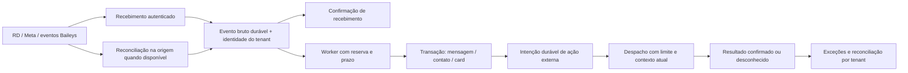

# Auditoria de resiliência e continuidade operacional

Data: 13/10/2026. Código analisado: `98630ff`. Empresas: Valem e Tecfag.

## Conclusão

O sistema tem persistência e recuperação parcial, mas **ainda não está preparado para garantir recuperação completa após duas horas de indisponibilidade**. Os maiores riscos são eventos RD que nunca chegam ao servidor, mensagens do navegador sem persistência, recebimentos Baileys sem caixa de entrada durável, envios com resultado desconhecido e automações interrompidas.

Retornar ao ar não significa recuperar tudo. É necessário recuperar também o trabalho acumulado, verificar o que foi efetivamente enviado e apresentar as exceções aos operadores.

Este documento é uma análise do repositório e das políticas públicas consultáveis dos provedores. Não é uma certificação do ambiente publicado: configurações efetivas do Railway, índices físicos, backups, volumes, canal ativo de cada empresa, logs e assinaturas remotas não foram inspecionados. Nenhum incidente foi provocado em produção; nenhuma mensagem, chamada, migração ou alteração operacional foi executada. As correções abaixo são propostas, ainda não implementadas nesta auditoria.

## 1. O que significa “o sistema caiu”

Os cenários precisam distinguir cinco componentes:

1. **Navegador do operador:** pode ficar sem internet enquanto servidor e canais continuam funcionando.
2. **Aplicação Node:** recebe webhooks, mantém Baileys/WebSockets, atende APIs e executa workers.
3. **PostgreSQL:** guarda mensagens, contatos, conversas, cards, credenciais e pendências.
4. **Provedores:** WhatsApp/Meta, RD, Vertex AI, SMTP e telefonia podem falhar independentemente.
5. **Infraestrutura de entrada e armazenamento:** DNS, HTTPS, proxy, rede, disco e deploy.

A queda da aplicação, com banco preservado, é diferente da perda do banco. Uma fila no mesmo PostgreSQL protege contra reinício do Node; não recebe eventos quando aplicação e banco estão inacessíveis. A proteção contra esse segundo caso exige entrada durável independente ou recuperação verificável na origem.

O canal deve seguir a configuração de cada tenant. A análise diferencia Meta e Baileys, sem fixar o canal de Valem ou Tecfag. A implantação deve preservar a operação da Valem e manter as funcionalidades de IA autorizadas por empresa.

## 2. Resposta ao cenário de duas horas fora do ar

Exemplo: aplicação indisponível das 10h às 12h, banco preservado.

| Situação às 10h | Durante a queda | Quando a aplicação retorna |
| --- | --- | --- |
| Mensagem já aceita pelo WhatsApp | Sua entrega passa a depender do provedor e do destinatário | Não deve ser reenviada só porque houve reinício; aceitação não comprova entrega ou leitura |
| Operador tenta enviar e a requisição não chega ao servidor | Não existe registro durável no servidor | Não há envio automático posterior; a fila do chat está na memória do navegador |
| Envio Baileys gravado como `sending`, interrompido pelo crash | Registro permanece no banco | Worker pode reenviar, com limite de tentativas; existe risco de duplicação se o provedor já havia aceitado |
| Envio já marcado como `failed` | Falha fica no banco | Worker de saída não seleciona `failed`; exige tratamento manual |
| Envio Meta interrompido em `sending` | Registro permanece no banco | Worker muda para `unknown` e não reenvia, para evitar duplicação |
| Envio Meta com timeout | Pode ter sido aceito mesmo sem resposta HTTP | Fica `unknown`; rota de reconciliação atual não aceita esse status |
| Cliente envia pelo canal Meta | Aplicação não recebe enquanto está indisponível | Depende de nova entrega do webhook pelo provedor; eventos já persistidos podem ser retomados localmente |
| Cliente envia pelo canal Baileys | Sessão do sistema está offline; WhatsApp pode manter mensagens fora dele | Reconexão pode entregar pendências, mas o código não cobre integralmente histórico e eventos `append` |
| RD dispara evento para criar card | Endpoint não recebe o evento | Card só será criado se o RD entregar novamente ou houver recuperação externa; não há busca automática de eventos perdidos |
| Evento RD já confirmado no banco, mas resposta HTTP se perde | Card, contato e recibo foram confirmados juntos | Reenvio do mesmo evento é reconhecido, dentro da identidade configurada do fluxo |
| Triagem SDR aguardando resposta | Timer e lote em memória desaparecem | Recuperação só examina interações dos últimos 30 minutos; triagem parada há duas horas pode ficar abandonada |
| Tarefa/atividade CRM já salva | Registro continua existindo, sem execução durante a queda | Pode aparecer vencida quando o operador retorna; lembretes e ações externas exigem política própria |
| Visitante tenta enviar no widget do site | Bolha local pode aparecer sem envio efetivo | Widget reconecta, mas não mantém uma fila durável para reenviar a mensagem |

Para mensagens recebidas **durante** a queda, não há registro local até o evento ser entregue. O worker local não consegue recuperar sozinho algo que nunca entrou no banco.

Para mensagens **que ainda seriam geradas**, como resposta de IA ou follow-up, pode não existir sequer uma intenção de envio persistida. Elas também não são abrangidas automaticamente pela recuperação da tabela `messages`.

## 3. Proteções que já existem

- Envio unificado do operador grava uma mensagem `sending` antes de chamar o adaptador e usa chave de idempotência. [Código](../src/lib/whatsapp/outbound.ts).
- Plugin de recuperação inicia o worker, com ciclo imediato e intervalo de 30 segundos. Seleciona saídas `sending` antigas e entradas `pending`, `processing` e `failed`. [Plugin](../server/plugins/recovery.ts), [worker](../src/lib/whatsapp/recovery.ts).
- Webhook Meta valida assinatura e resolve empresa pelo número cadastrado; processa os itens do lote e retorna erro quando há falha acionável. [Webhook](../src/routes/api/webhooks/meta.ts).
- Entradas Meta guardam payload em `pending_inbounds`; falhas no download de mídia também podem ser guardadas para nova tentativa. [Processamento](../src/lib/whatsapp/inbound.ts).
- Status Meta recebidos antes de haver vínculo com a mensagem são guardados; atualização de status evita regressão simples de leitura para entrega. [Status](../src/lib/whatsapp/meta-status.ts).
- Integração RD Marketing confirma recibo, contato e card na mesma transação; índice único usa empresa, fluxo e identidade. [Serviço](../src/lib/rd-marketing/service.ts:244), [schema](../src/db/schema.ts:80).
- Credenciais Baileys ficam no PostgreSQL; há reconexão com espera crescente para falhas elegíveis. [Sessão](../src/lib/baileys/session-manager.ts:124).
- Chat do operador reconecta SSE e busca novamente parte das conversas. [Frontend](../src/hooks/useChatState.tsx:3015).
- Mídias possuem caminhos de persistência no banco além de cache local. Isso reduz dependência do disco do container, quando a gravação conclui.

Essas proteções são úteis, mas algumas têm lacunas nos estados, na concorrência, na preservação dos dados de envio e na retomada após falhas longas.

## 4. Achados prioritários com evidências

### R01 — RD sem recebimento durável separado da criação do card — P0

`POST /api/webhooks/rd-marketing/$token` executa `receiveLeads` e só depois responde. O recibo é confirmado na mesma transação do card. Se validação ou criação falhar, tudo volta atrás. O log de erro guarda mensagem de erro, sem o payload necessário para repetir a operação.

O comportamento evita um recibo de sucesso para um card inexistente, mas não oferece uma caixa de entrada independente. Se o RD esgotar entregas, o sistema não terá um evento aguardando correção e reprocessamento. Um lead inválido também faz o lote inteiro voltar atrás.

**Correção:** autenticar a origem, guardar o evento bruto e a versão da configuração do fluxo, confirmar recebimento e processar depois. Cada item deve ter resultado e erro próprios. Disponibilizar replay por empresa e evento, preservando a idempotência da criação.

**Evidências:** [rota](../src/routes/api/webhooks/rd-marketing/$token.ts:52), [transação](../src/lib/rd-marketing/service.ts:257), [log](../src/routes/api/webhooks/rd-marketing/$token.ts:59).

### R02 — Falta recuperação RD de eventos que nunca chegaram — P0

Não foi localizado mecanismo automático de reconciliação de eventos RD Marketing perdidos. A importação administrativa do **RD CRM** existe, mas trata outro produto e não garante reconstrução das conversões que gerariam cards locais.

A documentação oficial de retentativas do RD descreve três reenvios e timeout de cinco segundos. Não informa nessa página um intervalo que permita afirmar que as tentativas cobrem duas horas. O RD Marketing também documenta suspensão de webhooks por erros persistentes. A modalidade efetivamente cadastrada deve ser verificada, porque RD CRM tem política própria.

**Correção:** usar recebimento durável independente da aplicação principal para proteger quedas longas; complementar com reconciliação na origem quando a API disponibilizar os eventos necessários. Guardar cursor e intervalo de reconciliação, com sobreposição e deduplicação. Verificar se é possível recuperar cada ocorrência e sua atribuição, não apenas o estado atual do contato. Caso a origem não exponha os eventos, declarar a limitação e manter procedimento de reenvio/exportação assistida.

**Evidências:** [integração Marketing](../src/lib/rd-marketing/service.ts), [importador CRM](../src/routes/api/crm/import/rd-crm.ts), [RD: retentativas](https://developers.rdstation.com/reference/retries-logic), [RD Marketing: suspensão](https://developers.rdstation.com/changelog/suspens%C3%A3o-de-webhooks), [política específica CRM](https://developers.rdstation.com/reference/crm-v1-webhooks).

### R03 — Recebimento Baileys incompleto na retomada — P0

Listener processa apenas `messages.upsert` do tipo `notify`, excluindo mensagens `fromMe`. Não foi localizado listener de `messaging-history.set` ou importação de `append`. O caminho escreve diretamente em contatos/conversas/mensagens, sem registrar antes o evento bruto em `pending_inbounds`. Erros de gravação são registrados no console.

A documentação do Baileys distingue notificações e inclusão de outras mensagens, incluindo sincronização offline. Portanto, reconectar não comprova que todas as mensagens ausentes passaram pelo banco. Atendimento emergencial pelo celular também não tem importação garantida no fluxo observado.

**Correção:** persistir entrada antes do processamento, tratar histórico e `append` com identidade estável e preservar timestamp do provedor. Importar mensagens históricas sem disparar respostas automáticas antigas. Reconciliar o período ausente e testar atendimento pelo celular.

**Evidências:** [listener](../src/lib/baileys/session-manager.ts:546), [gravação](../src/lib/baileys/session-manager.ts:1278), [erro](../src/lib/baileys/session-manager.ts:1490), [documentação Baileys](https://github.com/WhiskeySockets/baileys.wiki-site/blob/main/docs/socket/receiving-updates.md).

### R04 — Fila do operador desaparece e falha não preserva conteúdo — P0

`ChatPanel` mantém itens em `useRef`, limpa texto/anexos antes de o servidor confirmar e remove cada tarefa da fila antes de enviar. Resultado `false` não recoloca o item. No hook, erro remove a mensagem otimista. Recarregar a aba também perde tarefas ainda não aceitas pelo backend.

Novo envio manual gera nova chave, então um timeout pode levar o operador a enviar novamente algo já aceito pelo provedor. A proteção por chave só ajuda quando a mesma chave é preservada.

**Correção:** persistir intenção e chave antes do envio; manter texto, anexos e vínculo explícito com empresa/conversa. Exibir pendente, falha ou resultado desconhecido; consultar o servidor antes de repetir. Separar recuperação de rascunho de autorização para disparar mensagem antiga após mudança de operador, empresa ou contexto.

**Evidências:** [fila](../src/components/chat/ChatPanel.tsx:765), [processamento](../src/components/chat/ChatPanel.tsx:1476), [limpeza](../src/components/chat/ChatPanel.tsx:1542), [chave e erro](../src/hooks/useChatState.tsx:1573).

### R05 — Estado `unknown` Meta não tem reconciliação manual funcional — P0

Adaptador e worker produzem `unknown`, mas `/api/chats/reconcile-message` admite somente `uncertain`, `failed` e `sending`. Além disso, a rota executa um novo envio; não consulta o provedor para descobrir se o anterior foi entregue. A indicação de “reconciliação manual” no erro não corresponde a uma recuperação completa.

Status Meta dependem de `externalId`. Se o crash acontecer depois da aceitação externa e antes de guardar esse ID, um webhook com WAMID não pode ser automaticamente vinculado por esse caminho. Status sem vínculo acabam consumindo tentativas do worker.

**Correção:** unificar estados; distinguir consulta/verificação de reenvio; mostrar incerteza e evidências. Não prometer consulta de histórico/status que a API não ofereça. Quando não houver correlação confiável, encaminhar para avaliação humana antes de reenviar.

**Evidências:** [worker](../src/lib/whatsapp/recovery.ts:96), [adaptador](../src/lib/whatsapp/adapters/meta.ts), [elegibilidade](../src/routes/api/chats/reconcile-message.ts:90), [correlação](../src/lib/whatsapp/meta-status.ts:27).

### R06 — Recuperação perde anexos e características do envio — P0

Worker e rota manual reconstroem envio com `text: msg.content`, sem mídia, arquivo, template, variáveis, citação ou BSUID. Saída Baileys nem guarda todos esses parâmetros. Um anexo interrompido pode ser reenviado como seu marcador textual, por exemplo `[MEDIA:document]...`, em vez do arquivo.

**Correção:** guardar envelope completo de despacho para todos os canais, usando referência durável da mídia e identidade de destinatário validada. Restaurar o envelope e validar novamente condições do envio. Se a mídia não estiver persistida, não confirmar aceitação durável.

**Evidências:** [registro](../src/lib/whatsapp/outbound.ts:163), [reconstrução](../src/lib/whatsapp/recovery.ts:157), [rota manual](../src/routes/api/chats/reconcile-message.ts:138), [gravação de mídia com erro tolerado](../src/routes/api/whatsapp/send.ts:162).

### R07 — Exclusão mútua dos workers não dura o processamento — P0

Recovery e inbound usam locks `pg_*_advisory_xact_lock` em `db.execute` fora de uma transação explícita que englobe o trabalho protegido. O lock pertence à transação do comando e é liberado antes dos passos seguintes. A flag de ciclo protege apenas o processo atual. Recuperação e reenvio manual também usam nomes diferentes de lock. A liberação ao fim da transação é documentada pelo [PostgreSQL](https://www.postgresql.org/docs/current/explicit-locking.html#ADVISORY-LOCKS).

**Correção:** reservar tarefa atomicamente no banco com status, dono e prazo de reserva, por exemplo claim condicional e lease. Usar `SKIP LOCKED` quando apropriado. Evitar transação longa durante chamadas externas. Proteger workers simultâneos, deploy sobreposto e retomada de reserva expirada.

**Evidências:** [recovery](../src/lib/whatsapp/recovery.ts:81), [inbound](../src/lib/whatsapp/inbound.ts:64), [manual](../src/routes/api/chats/reconcile-message.ts:33).

### R08 — Inicialização tem comandos potencialmente destrutivos — P0

`railway.json` inclui `drizzle-kit push --force`, seed e reset condicional por `RESET_DATA`. Isso é a configuração versionada, cuja adoção efetiva no serviço publicado precisa ser confirmada. O seed evita preencher banco que já possui operadores, mas ainda realiza DDL/limpeza antes dessa verificação.

O reset legado trunca `media_files` integralmente, embora o schema atual tenha `tenantId`. Se habilitado, pode atingir mídia de ambas as empresas. Não se deve executá-lo para investigar esta auditoria.

Índices únicos críticos de WhatsApp existem na migration `0008`, mas não estão declarados no schema atual nem na lista do migrador usado por `npm start`, que começa em `0009`. A existência física desses índices precisa ser verificada; não é seguro presumir que estão presentes só porque o código trata violação de unicidade.

**Correção:** startup sem reset/seed operacional e sem sincronização destrutiva automática de schema. Migrações aditivas versionadas, verificação explícita de constraints e backup restaurável antes de publicação. Remover caminho de reset automático e tratar ferramentas administrativas separadamente.

**Evidências:** [Railway](../railway.json:4), [seed](../src/db/seed.ts:18), [reset](../src/db/reset-data.ts:53), [índices](../src/db/migrations/0008_mvp_idempotency_unique_and_recovery.sql), [schema](../src/db/schema.ts:294), [migrador](../scripts/apply-platform-access-migration.mjs:35).

### R09 — Health check pode indicar saúde falsa — P0

`/api/health` sempre retorna 200. Em produção não testa o banco; fora de produção, mesmo `unreachable` continua retornando 200. Não verifica se o worker está executando. Há um diagnóstico administrativo com teste de banco, mas ele não é o endpoint usado no Railway.

**Correção:** separar processo vivo de aplicação pronta. Readiness testa banco/schema com timeout curto e retorna 503 em falha essencial. Estado por canal e heartbeat dos workers deve aparecer no monitoramento, sem exigir que falha exclusiva da IA derrube atendimento humano. Monitorar de fora da própria aplicação.

**Evidências:** [health](../src/routes/api/health.ts:17), [configuração](../railway.json:5), [diagnóstico administrativo](../src/routes/api/gestao/health.ts).

### R10 — Retentativas curtas, sem fila de exceções operacional — P1

Saída só retoma `sending`; falha imediata de canal vira `failed` e deixa a seleção automática. Entrada usa `createdAt`, não `nextRetryAt` nem uma reserva de processamento. Tentativas são incrementadas no worker e novamente na retomada do inbound. O limite pode ser consumido rapidamente enquanto a dependência continua indisponível. Eventos de status sem vínculo também podem chegar a `error` antes do vínculo existir.

**Correção:** diferenciar falha temporária, permanente e incerta; usar espera crescente com variação, próxima tentativa e limite por tempo. Não gastar tentativas de negócio por indisponibilidade conhecida de infraestrutura. Manter fila de exceções com erro, payload, tentativas, prazo, replay e trilha de ações, por tenant.

**Evidências:** [seleção e limite](../src/lib/whatsapp/recovery.ts:210), [retomada](../src/lib/whatsapp/inbound.ts:96), [falha de saída](../src/lib/whatsapp/outbound.ts:262).

### R11 — Entrada Meta não confirma todos os efeitos atomicamente — P1

Contato/conversa, contador, mensagem e conclusão do evento são gravados em etapas. Mensagem tem ID aleatório e não há índice único de `messages(tenantId, externalId)` no schema analisado. Crash depois de inserir mensagem, antes de concluir evento, permite repetir inserção e efeitos de contador. A prevenção pelo recibo concluído não cobre essa janela.

**Correção:** identidade única por mensagem externa, operações transacionais ou retomada idempotente de cada etapa, incremento atômico e proteção contra evento atrasado substituir preview recente. Efeitos externos/notificações devem ter intenção própria persistida e chave.

**Evidências:** [incremento](../src/lib/whatsapp/inbound.ts:370), [inserção](../src/lib/whatsapp/inbound.ts:446), [conclusão](../src/lib/whatsapp/inbound.ts:510), [schema](../src/db/schema.ts:295).

### R12 — Automações não compartilham a proteção do operador — P1

SDR, follow-up, bridge do site e relatórios usam caminhos de envio direto. Debouncers e locks da IA ficam em memória. Recuperação SDR só considera últimos 30 minutos, no máximo dez mensagens recentes, e deriva telefone do ID de contato em vez de ler telefone do cadastro. Esse ID não é uma identidade de telefone confiável.

Follow-up tem plugin próprio, mas não está na lista explícita de plugins do `vite.config.ts`. É necessário verificar registro efetivo no build, sem assumir que o arquivo presente significa job ativo. SLA, auditoria e supervisor são iniciados em imports de rotas de gestão; comprovar execução independentemente de abertura do painel.

**Correção:** tarefas duráveis para IA e ações externas; startup explícito e monitorado; seleção de empresas autorizadas; retomada por pendência real, não só por janela curta. Aplicar expiração, horário comercial, contexto atual e intervenção humana a ações atrasadas. Toda IA continua pelo serviço central Vertex, com feature e tenant.

**Evidências:** [debounce](../src/lib/valentina/sdr-debouncer.ts:26), [retomada](../src/lib/valentina/sdr-recovery.ts:8), [telefone](../src/lib/valentina/sdr-recovery.ts:89), [envio SDR](../src/lib/valentina/sdr-engine.ts:1504), [follow-up](../server/plugins/sdr-followup.ts), [registro plugins](../vite.config.ts:32), [inicialização gestão](../src/routes/api/gestao/alerts.ts:12).

### R13 — Auditorias e relatórios podem ficar abandonados — P1

Auditoria muda para `processing`, mas seleção automática busca apenas `pending`; crash pode deixá-la presa. Consulta inicial também não filtra por tenant, contrariando as regras do projeto.

Relatório já criado bloqueia nova geração, mesmo se dispatch falhou. Dispatch parcial pode marcar todo relatório como enviado; falta resultado durável por destinatário/canal. Não há recuperação de todos os períodos perdidos e datas misturam hora de São Paulo com dia UTC.

**Correção:** leases e recuperação de auditorias, feature gate por empresa, agenda persistida por período e fuso; estado por destinatário; reenvio apenas de destinos comprovadamente pendentes; preservação da aprovação humana configurada.

**Evidências:** [auditoria](../src/lib/audit-service.ts:99), [processing](../src/lib/audit-service.ts:133), [relatórios](../src/lib/sla-engine.ts:170), [dispatch](../src/lib/report-dispatcher.ts:28).

### R14 — Widget reconecta, mas mensagem não enviada não é recuperada — P1

Widget adiciona bolha local antes de verificar WebSocket. Se estiver fechado, avisa e reconecta, sem guardar/retransmitir a mensagem. Servidor gera outro ID ao salvar; não há protocolo durável de confirmação por chave do cliente. Histórico padrão consulta as primeiras 50 mensagens em ordem crescente, podendo omitir as recentes numa conversa longa.

**Correção:** chave estável e confirmação após persistência; fila local por visitante/empresa; deduplicação no servidor; paginação correta; indicação explícita de envio pendente. Recuperar resposta da IA como tarefa, sem depender do debounce em RAM.

**Evidências:** [widget](../valem-widget/src/widget.ts:1486), [storage](../src/lib/livechat/livechatStorage.ts:144), [histórico](../src/lib/livechat/livechatStorage.ts:168), [debouncer](../src/lib/livechat/livechatDebouncer.ts).

### R15 — SMTP, telefonia e OAuth têm janelas de incerteza — P1

E-mail CRM envia SMTP antes de registrar histórico. Há retorno 202 para falha de histórico quando a execução continua, mas crash nessa janela não deixa intenção durável. Aceitação SMTP não comprova entrega ao destinatário.

Salas WebRTC e sinais ficam em RAM. Chamada P2P já estabelecida pode continuar enquanto conexão direta existir, mas novas conexões/sinalização e controle dependem do servidor. Streaming de telefonia hospedado na aplicação perde continuidade com a queda. Não foram encontradas retomada completa ou reconciliação de chamadas no caminho examinado.

RD CRM usa refresh token rotativo. Falha ao persistir novo token é tolerada, mantendo-o apenas em memória; reinício pode perder a credencial renovada. Refresh simultâneo também precisa ser serializado por empresa.

Há credenciais de telefonia embutidas no código. Sua remoção e rotação devem entrar na correção, sem reproduzir os valores em documentação ou logs.

**Correção:** intenção durável de e-mail/chamada, estados claros de aceitação e conclusão, correlação pelo ID externo, callback validado e recuperação dos registros. Telefonia precisa ter mensagem/rota de contingência externa ao serviço principal. Persistência de credencial rotativa deve ser obrigatória e monitorada.

**Evidências:** [e-mail](../src/routes/api/crm/deals/$dealId/emails/send.ts), [sinalização](../src/lib/call-signaling.ts:32), [chamada](../src/lib/voice/outbound-call-service.ts), [tokens](../src/lib/rdCrmService.ts:50).

### R16 — Recuperação pode interferir entre empresas — P0 transversal

Foram observadas consultas sem filtro tenant em recuperação SDR, follow-up e seleção de auditorias, além do truncamento global de mídia no reset legado. Mesmo que IDs globais reduzam uma colisão específica, essas operações descumprem o contrato de isolamento e não devem servir de base para replay em lote.

O worker geral também percorre empresas sequencialmente, sem limite de lote por empresa. Uma pendência volumosa ou lenta pode atrasar a outra.

**Correção:** sessão como autoridade em rotas internas; IDs e filtros tenant em todas as operações; identidade composta nas filas; autorização para replay; quotas e concorrência justa por empresa. Valentina e Fagner mantêm persona e feature gates corretos. Canal original da intenção e canal configurado devem ser verificados sem trocar provedor automaticamente.

## 5. Matriz ampliada de cenários

“Risco” abaixo significa consequência possível a partir do código, não incidente já observado.

| # | Cenário | Comportamento/risco atual | Condição necessária para recuperação segura |
| --- | --- | --- | --- |
| 01 | Node fora por 2h, banco intacto | Recuperação parcial; eventos não recebidos dependem da origem | Inbox/outbox, entrada independente e reconciliação |
| 02 | Navegador sem internet | Servidor pode continuar; fila local e rascunhos não têm durabilidade completa | Intenção local, ACK e consulta antes de repetir |
| 03 | Aba fechada enquanto há envios em fila | Itens apenas em RAM desaparecem | Persistência antes de limpar composer |
| 04 | API recebeu mensagem, resposta ao navegador se perdeu | Operador pode repetir com chave nova | Chave estável e consulta por intenção |
| 05 | Crash antes da chamada ao WhatsApp | Registro `sending` existe, mas situação parece igual à de aceitação incerta | Estados/reserva e trilha de tentativa |
| 06 | Crash após aceitação externa, antes de salvar ID | Baileys pode duplicar; Meta fica desconhecido | Correlação e tratamento de incerteza |
| 07 | Canal desconectado com servidor disponível | Adaptador marca falha; saída não é retomada automaticamente | Fila aguarda canal com política de expiração |
| 08 | Meta timeout/reset de rede | Resultado desconhecido; reconciliação atual incompatível | Verificação assistida sem reenvio automático |
| 09 | Status chega antes do vínculo do envio | Há pendência, mas tentativas podem acabar cedo | Retenção adequada e correlação posterior |
| 10 | Status fora de ordem ou repetido | Há proteção de progressão; concorrência exige retentativa | Idempotência e atualização condicional |
| 11 | Webhook repetido durante processamento | Locks insuficientes; efeitos podem duplicar | Claim/lease e unicidade por evento/mensagem |
| 12 | Cliente envia várias mensagens durante a queda | Baileys pode omitir histórico; Meta depende de reentrega | Recuperação ordenada e detecção de lacunas |
| 13 | Mesmo evento Baileys chega novamente | Mensagem pode ser deduplicada, mas contador/SLA/IA já sofreram efeitos | Deduplicação antes de efeitos |
| 14 | Atendimento pelo celular como contingência | `fromMe` excluído do recebimento observado | Sincronizar histórico sem automação retroativa |
| 15 | Sessão Baileys revogada/logout | Reconexão não resolve e requer intervenção | Alerta com ação de reconexão autorizada |
| 16 | Deploy com duas instâncias | Sessão pode ser substituída; locks locais não coordenam | Um proprietário por sessão e workers distribuídos |
| 17 | Aplicação inicia antes do banco | Auto-boot pode falhar sem novo ciclo de boot | Retry de startup e readiness real |
| 18 | Banco cai por 2h | Recebimento/persistência bloqueiam; filas no mesmo banco não aceitam novos eventos | Entrada externa durável e restauração da dependência |
| 19 | Banco lento, pool cheio ou lock longo | Webhooks demoram, novos retries ampliam pressão | Timeout, limite de trabalho e ACK rápido |
| 20 | Banco perdido ou corrupção/exclusão | Recuperação limitada ao backup disponível | Backup/PITR, cópia independente e restore ensaiado |
| 21 | Disk/container substituído | Cache de mídia desaparece; arquivos com DB intacto podem ser recuperados | Arquivo durável comprovado, checksum e política de retenção |
| 22 | Falha ao persistir anexo | Envio pode ocorrer sem recuperação durável do arquivo | Falhar aceitação quando arquivo não estiver preservado |
| 23 | RD endpoint responde lentamente | Provedor pode repetir enquanto processamento continua | Persistir e responder dentro do orçamento do provedor |
| 24 | RD encerra retries ou suspende webhook | Cards novos param; retorno do servidor não basta | Alerta, reativação assistida e recuperação na origem |
| 25 | Um lead do lote RD é inválido | Transação de todos os cards volta atrás | Quarentena por item com payload preservado |
| 26 | Mapping/etapa/responsável mudam durante queda | Replay usa configuração atual ou pode falhar | Snapshot/versionamento e validação da configuração |
| 27 | Fluxo/token RD desativado ou rotacionado | URL antiga é rejeitada; eventos em voo precisam de política | Grace period controlado e isolamento da origem |
| 28 | Vertex AI indisponível/lento | IA pode parar; debounce perdido não é tarefa durável | Fallback humano, limite de tempo e retomada contextual |
| 29 | Crash durante auditoria | `processing` fica fora da seleção automática | Lease e retomada com custo/idempotência controlados |
| 30 | Queda cruza horário de relatório ou dia | Não recupera necessariamente período perdido; envio falho pode não voltar | Agenda persistida e fuso único |
| 31 | Follow-up retorna muito atrasado | Contato pode já estar atendido; ações diretas podem repetir | Expiração e revalidação do atendimento |
| 32 | E-mail aceito, histórico não salvo | Mensagem pode ser enviada sem prova local | Outbox e resultado incerto visível |
| 33 | Chamada/stream interrompido | Controle/stream perde estado; chamada remota pode persistir | Callback, consulta por ID e contingência |
| 34 | OAuth renovou token, banco falhou | Cache funciona até reinício e pode perder novo refresh token | Persistência obrigatória e refresh serializado |
| 35 | URL, DNS, HTTPS ou proxy quebrados | Aplicação pode estar viva e webhooks inacessíveis | Monitoramento externo do caminho real |
| 36 | Grande volume após retorno | Sem limites por lote/empresa, recuperação pode saturar banco e integrações | Drenagem gradual, ordem por conversa e quotas |
| 37 | Troca de canal com mensagens antigas pendentes | Alguns caminhos respeitam provedor original; automações diretas não | Política explícita de migração das intenções |
| 38 | Operador transfere/finaliza conversa enquanto há tarefa pendente | Resposta atrasada pode interferir no atendimento | Revalidar posse, contexto e versão antes de ação |
| 39 | Uma empresa produz evento problemático em loop | Pode consumir recursos compartilhados e atrasar outra | Quarentena e justiça de processamento por tenant |
| 40 | Monitoramento cai junto da aplicação | Console/health interno não avisam o incidente | Monitor externo e canal de alerta independente |

## 6. Arquitetura recomendada



Esse desenho deve ser implementado em etapas. PostgreSQL pode atender inbox/outbox do processo sem introduzir um broker inicialmente. Para receber RD durante queda completa do serviço principal, o ponto de entrada precisa ter domínio de falha e armazenamento independentes. Apenas outro worker no mesmo serviço não resolve.

### Dados mínimos de uma intenção/evento

- Empresa, origem, ID externo, chave de idempotência e correlação.
- Payload original e versão da configuração relevante, com proteção de acesso e retenção definida.
- Tipo de ação e envelope completo: destinatário, canal original, texto, mídia, template, variáveis e citação.
- Hora original do evento, hora de recebimento e próxima tentativa.
- Estado, número de tentativas, último erro, proprietário da reserva e vencimento da reserva.
- Prazo de validade da ação, resultado externo, timestamps e trilha de reprocessamento manual.

### Regras de execução

1. Confirmar recebimento/aceitação local somente depois de guardar duravelmente a intenção.
2. Usar uma chave estável por operação; criar novo intento apenas quando houver ação nova autorizada.
3. Reserva atômica evita dois workers executarem a mesma tarefa; reserva expirada é recuperável.
4. Falha temporária aguarda; falha permanente vai para exceção; resultado desconhecido exige reconciliação.
5. Preservar ordem por conversa e impedir evento atrasado de substituir informação recente.
6. Revalidar contexto antes de automação atrasada: operador assumiu, cliente respondeu, conversa finalizada, janela Meta, horário comercial e feature gate.
7. Reprocessar evento deve produzir o mesmo efeito interno uma única vez. Uma transação local não garante, sozinha, envio externo exatamente uma vez.
8. Ter quotas por empresa e limites por provedor para que retomada não comprometa Valem.
9. Não usar mensagem antiga para renovar artificialmente a janela de atendimento; usar timestamp original. Templates exigem validação atual.
10. Não iniciar reenvio em massa após restaurar backup: o provedor pode ter enviado mensagens depois do ponto restaurado.

## 7. Plano de execução por entregas

| Entrega | Trabalho concreto | Critério para concluir |
| --- | --- | --- |
| 0 — Proteção operacional | Verificar configuração efetiva de deploy, eliminar reset automático, garantir índices críticos, readiness e backup restaurável | Restart seguro sem tocar dados reais; diagnóstico de banco falho retorna indisponibilidade |
| 1 — RD | Inbox de payloads, worker, quarentena por item, replay, snapshot do fluxo e estratégia de captura externa/reconciliação | Evento aceito sobrevive a crash; repetição cria um card; queda longa não fica silenciosa |
| 2 — Saída WhatsApp | Envelope completo, estados unificados, claim/lease, política de retries e reconciliação de desconhecidos | Crash em cada etapa tem resultado conhecido; mídia recupera como mídia; sem reenvio cego |
| 3 — Entrada WhatsApp | Inbox Baileys/histórico, idempotência Meta transacional e timestamps preservados | Período offline recuperado sem duplicar mensagem, contador, SLA ou resposta |
| 4 — Operador/widget | Pendências locais estáveis, confirmação, falha visível e recuperação após reload | Conteúdo não desaparece silenciosamente; pendência sempre mantém empresa/conversa |
| 5 — Automações | Jobs IA, follow-up, auditoria, relatórios, bridge, SMTP e telefonia com durabilidade e expiração | Reinício não abandona job e não dispara ação comercial obsoleta |
| 6 — Operação comprovada | Painel de exceções, métricas, alerta externo, testes de falha e restore | Evidências de recuperação isolada das duas empresas e procedimento de incidente ensaiado |

Entrega aditiva, com validação em banco e credenciais de teste. Não desconectar Valem nem mudar canal como parte dos testes. Não ativar SDR/supervisor/auditoria Tecfag antes do go-live. Não reescrever histórico Git sincronizado com Lovable.

## 8. Testes necessários para declarar o sistema preparado

Os testes abaixo são o critério futuro de aceitação; não foram executados nesta auditoria.

### Ambientes e provas

Usar base PostgreSQL local/descartável com isolamento verificado e adaptadores falsos/sandbox. Não executar `verify-mvp-suite.ts` contra ambiente operacional: a suíte altera configuração de canal e usa nomes dos tenants reais.

Não basta testar estado final em memória. Reiniciar o processo real entre etapas, preservar banco/arquivo durável e verificar pelo ID estável cada mensagem, evento, card e efeito externo observado pelo adaptador.

### Casos obrigatórios

1. **Duas horas:** parar consumidor por duas horas ou simular relógio de jobs, receber eventos na entrada independente e retomar. Comprovar ausência de perdas; relógio simulado não substitui o ensaio de rede/infraestrutura.
2. **Crash por etapa:** antes/depois de persistir intenção, reservar tarefa, aceitar no provedor, guardar ID, inserir mensagem e concluir evento.
3. **Aceitação incerta:** provedor aceita e resposta se perde. Nenhum reenvio automático sem evidência segura.
4. **Concorrência:** dois workers, duas requisições de replay e deploy sobreposto; um efeito de negócio por identidade.
5. **Webhook repetido:** repetir em sequência e simultaneamente; contador/SLA/IA não duplicam.
6. **Lote parcialmente inválido:** evento RD/Meta com um item inválido; itens válidos concluem e inválido permanece recuperável.
7. **Mídias:** texto, foto, vídeo, áudio, documento, figurinha, citação e template preservados após reinício e troca do container.
8. **Banco indisponível/lento:** não confirmar durabilidade falsa; recuperar após retorno sem tempestade de retries.
9. **Provedor 429/5xx e token inválido:** retentativa somente onde apropriada; erro de credencial gera ação visível.
10. **Histórico Baileys:** `notify`, `append`, `messaging-history.set` e `fromMe`; preservar cronologia, sem responder automaticamente ao histórico antigo.
11. **Frontend/widget:** queda, recarga da aba, troca de conversa/empresa e envio parcial de anexos; preservar pendência e chave.
12. **Contexto mudou:** operador assume, conversa finaliza ou cliente responde antes do replay; cancelar ação obsoleta.
13. **Prazos:** janela de 24 horas Meta, horário comercial, dia/semana e limite de validade de follow-up.
14. **Fila acumulada:** carga equivalente ao período offline; limitar consumo por empresa e verificar atendimento novo durante a drenagem.
15. **Restore:** restaurar backup em ambiente isolado, incluir mídias/credenciais, medir tempo e reconciliar o intervalo posterior ao backup.
16. **Isolamento:** mesmos IDs externos e conteúdo em empresas distintas; nenhuma leitura, alteração, persona ou custo cruzado.

### Metas iniciais propostas, ainda não medidas

| Indicador | Meta de engenharia para homologação |
| --- | --- |
| Eventos já aceitos duravelmente e preservados no armazenamento | Zero perda por reinício da aplicação |
| Cards duplicados por replay da mesma identidade | Zero |
| Reenvio automático de despacho com resultado desconhecido | Zero |
| Detecção externa de indisponibilidade essencial | Até 2 minutos |
| ACK de webhook RD após gravação durável | p99 abaixo de 2 segundos, com orçamento inferior ao timeout do provedor |
| Tempo para retomar processamento após aplicação/dependências prontas | Até 1 minuto |
| Falha permanente ou retry esgotado | Sempre visível em fila de exceções |
| RPO/RTO de perda do banco | Definir após inventário de backup/PITR e ensaio de restore |

Zero perda por reinício pressupõe armazenamento preservado. Não é promessa de perda zero num desastre que destrua esse armazenamento. Tempo de drenagem deve ser medido com volume realista; não pode ser inferido só pelo intervalo do worker.

## 9. Monitoramento e procedimento de incidente

Monitorar por empresa: quantidade pendente, idade da mais antiga, heartbeat de worker, mensagens desconhecidas/falhas, eventos em quarentena, última reconciliação concluída, canal conectado e latência do banco/provedor. Verificar backups e capacidade de restauração em rotina operacional. Ausência de webhook sozinha pode significar ausência de tráfego, então combinar com testes sintéticos/configuração e volume esperado.

Quando houver queda:

1. Identificar componente afetado, horário de início e empresas impactadas, por monitor externo.
2. Preservar logs e dados; evitar reset, logout e reenvio indiscriminado.
3. Acionar atendimento alternativo já combinado, quando necessário; registrar ações manuais para reconciliação.
4. Restaurar aplicação/banco com versão compatível; verificar readiness, canal ativo e worker.
5. Verificar entregas e eventual suspensão RD; recuperar período ausente sem importar tudo cegamente.
6. Drenar filas gradualmente, priorizando atendimento e observando efeitos por tenant.
7. Resolver resultados desconhecidos com evidência antes de reenviar; revisar automações vencidas.
8. Confirmar mensagens, cards, atividades, relatórios e mídias do intervalo. Encerrar apenas quando exceções restantes tiverem responsável e destino.

## 10. Verificação realizada e limitações

Executado com sucesso:

```text
bun test test/rd-marketing-mapping.test.ts test/rd-marketing-selection.test.ts test/meta-identity.test.ts test/meta-template-variables.test.ts test/chat-message-queue-optimistic.test.ts
36 testes passaram, 0 falharam.
```

Esses testes verificam regras locais de mapeamento, identidade, templates e alguns comportamentos do chat. Não simulam duas horas de indisponibilidade, restauração de backup, falha do processo em cada etapa ou serviços externos reais. O teste de fila otimista não prova durabilidade da fila do navegador.

Também foram examinados startup/plugins, migrations/schema, canais de entrada/saída, estado dos workers, reconciliação manual, RD Marketing/CRM, frontend/widget, automações de IA, relatórios, auditorias, SMTP, telefonia, credenciais de sessão e diagnóstico de saúde.

Pendências para validação do ambiente publicado:

- Configuração efetiva do Railway e possíveis overrides do arquivo versionado; versão realmente publicada.
- Índices e constraints físicos, políticas de backup/PITR, retenção, volumes e restauração testada.
- Canal ativo, credenciais válidas e fluxo autorizado em cada empresa, sem expor segredos.
- Logs de startup comprovando execução dos plugins/workers e reconexão com banco temporariamente indisponível.
- Modalidade de webhook RD cadastrada, status ativo/suspenso, últimas entregas e possibilidades de replay/exportação/API.
- Política atual de entrega/retenção Meta aplicada à integração. A documentação oficial Meta de retry não pôde ser lida pela ferramenta de consulta; por isso não se afirma uma janela numérica de garantia.
- Volume real, horários comerciais, capacidade de drenagem e processo humano para resultados desconhecidos.

Não é possível garantir literalmente todos os incidentes. Esta matriz cobre os principais modos de falha dos caminhos examinados e fornece critérios objetivos para provar recuperação, ampliáveis conforme novos componentes sejam adicionados.

## 11. Fontes externas consultadas

- [RD: lógica de retentativas](https://developers.rdstation.com/reference/retries-logic).
- [RD Marketing: suspensão de webhooks](https://developers.rdstation.com/changelog/suspens%C3%A3o-de-webhooks).
- [RD CRM: política própria de webhooks](https://developers.rdstation.com/reference/crm-v1-webhooks).
- [RD Marketing: payload e timestamps](https://developers.rdstation.com/reference/webhooks-payload-mkt).
- [Baileys: eventos de recebimento](https://github.com/WhiskeySockets/baileys.wiki-site/blob/main/docs/socket/receiving-updates.md).
- [PostgreSQL: duração dos advisory locks](https://www.postgresql.org/docs/current/explicit-locking.html#ADVISORY-LOCKS).

As fontes ajudam a delimitar obrigações do provedor; não comprovam que a conta publicada está corretamente configurada ou que uma entrega específica ocorrerá.
