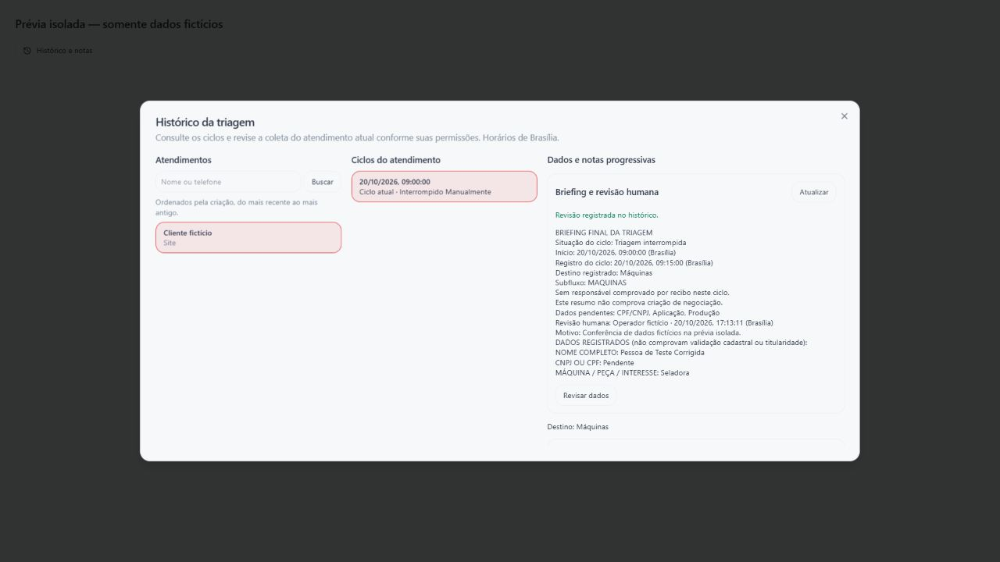

# Briefing final e revisão humana — E6, lote 4

Data: 20/10/2026. Continuação de `IMPLEMENTACAO-HISTORICO-NOTAS-2026-10-20.md`. Código e testes locais, sem ativação do SDR, publicação ou acesso ao banco da operação.

## Entrega

O histórico industrial oferece **Briefing e revisão humana** no ciclo atual. O briefing reúne situação do ciclo, coleta, pendências, destino, decisão de catálogo e responsável registrado no encaminhamento. Datas exibidas usam Brasília. O texto é determinístico, produzido das evidências persistidas, sem chamada adicional de IA.

Encaminhamento concluído, interrupção, arquivamento e continuidade preservam o briefing na nota do ciclo. Fluxos sem negociação também recebem esse registro. O encerramento industrial por falta de resposta agora registra estado e briefing na mesma transação; se o cliente retornar, a nota anterior continua disponível.

Quando o recibo do ciclo aponta uma negociação e o vínculo ativo é confirmado no mesmo tenant/conversa, a nota final ou a revisão é anexada às atividades desse card. A nota original de criação/vínculo do CRM é preservada. IDs determinísticos impedem duplicar a mesma nota e sua atividade. A notificação interna de distribuição também inclui o briefing do momento do encaminhamento, identificado como tal; revisões posteriores ficam no atendimento.

## Revisão da coleta

`GET/POST /api/valentina/triage-review` usa `requireSession`; tenant e operador vêm exclusivamente da sessão. O perfil industrial e as permissões são conferidos. O POST aceita somente identificadores de consulta, revisão esperada, motivo e campos autorizados da coleta. Não aceita tenant, operador, destino, decisão de catálogo ou recibo informados pelo cliente.

- A edição se aplica somente ao ciclo atual. Histórico arquivado e resumos legados permanecem somente para consulta.
- Automação ativa sem responsável, encaminhamento pendente ainda ativo, atendimento finalizado ou continuado em outro canal impedem a edição, inclusive para administradores.
- Operadores precisam de acesso, permissão de editar dados e enviar notas, e posse do atendimento ou permissão de sobreposição. Administradores podem revisar uma coleta interrompida sem responsável.
- O formulário permite corrigir valores, marcar pendências ou registrar conferência sem alterar campos. Motivo é obrigatório. Documento marcado como preenchido precisa passar pela validação matemática existente; isso não comprova cadastro ou titularidade.
- A gravação trava conversa e fluxo, verifica ciclo e revisão esperada, e persiste coleta, autor real, motivo, nota e atividade CRM na mesma transação. Alteração concorrente retorna 409 e exige reconciliação pelo operador.
- Pedido/recibo de encaminhamento, responsável, carteira, contador e negociação original não são reescritos. Editar a coleta não reinicia IA ou rodízio. O cadastro do contato é gerido na tela própria; esta edição não o sincroniza automaticamente.
- Alterar documento elimina aliases conflitantes e o enriquecimento cadastral antigo da coleta. Alterar documento, interesse, modelo, aplicação, produção ou solicitação marca a decisão de catálogo para nova análise, sem criar outro encaminhamento.
- A revisão guarda uma impressão dos campos normalizados. Se a coleta mudar depois, a revisão anterior aparece como desatualizada, preservando autor e motivo. Ela não equivale a aprovação técnica de máquina ou de destino.

O resumo de texto tem limite de 10 mil caracteres e informa truncamento; os dados normalizados do ciclo continuam consultáveis. Resumos antigos sem coleta completa não são apresentados como briefings completos.

## Concorrência no encerramento sem resposta

`industrial-silence-store.ts` revalida tenant, conversa, ciclo mais recente, interação esperada e posse humana, na ordem de locks conversa → fluxo. Não encerra um ciclo substituído, nova coleta, atendimento humano ou encaminhamento pendente. A régua e os horários existentes continuam definidos pela política de silêncio; o caminho legado permanece separado.

## Validação

Resultados, configuração de tipos e hashes: `fagner-briefing-review-2026-10-20.json`.

- **258 testes Node em 24 suítes**, incluindo contrato, permissões, documento, revisão desatualizada, briefing e handlers autenticados.
- **55 cenários PostgreSQL** em schema privado de banco local. Cobrem revisões concorrentes, conflito de versão/ciclo, tenant/operador alheio, preservação de recibo e rodízio, atividade no mesmo card, invalidação cadastral, rollback em falha da nota/atividade e registro durável de sem resposta.
- Build e lint dos 12 arquivos de núcleo/interface/rota/testes desta etapa aprovados. TypeScript inclui o plugin de recuperação e mantém os 21 diagnósticos anteriores, sem novos problemas. O repositório ainda não tem aprovação global de tipos ou lint.
- Conferência em navegador dos componentes reais, em servidor isolado sem configuração da aplicação e com APIs inteiramente fictícias: abrir histórico, selecionar ciclo, visualizar briefing, editar, exigir motivo, salvar e atualizar notas. A imagem abaixo é dessa prévia; não é atendimento real nem homologação de autenticação ou transporte.

## Continuidade

A equipe ainda precisa homologar revisão, distribuição e notificações com os provedores reais. Seleção/aprovação técnica de máquina, mudança de destino e ações cadastrais continuam nos seus fluxos próprios; este formulário não os automatiza. Também continuam pendentes origem/produto/campanha do site, VTEX/preço/frete/pedido, score, avaliação, relatórios e exportações conforme a [matriz de paridade](./MATRIZ-PARIDADE-FAGNER-2026-10-20.md).

Sem Vertex, canais reais, migrations/seeds da operação, importação, commit/push ou virada nesta entrega. PostgreSQL e servidor da prévia são desligados ao concluir a verificação.
