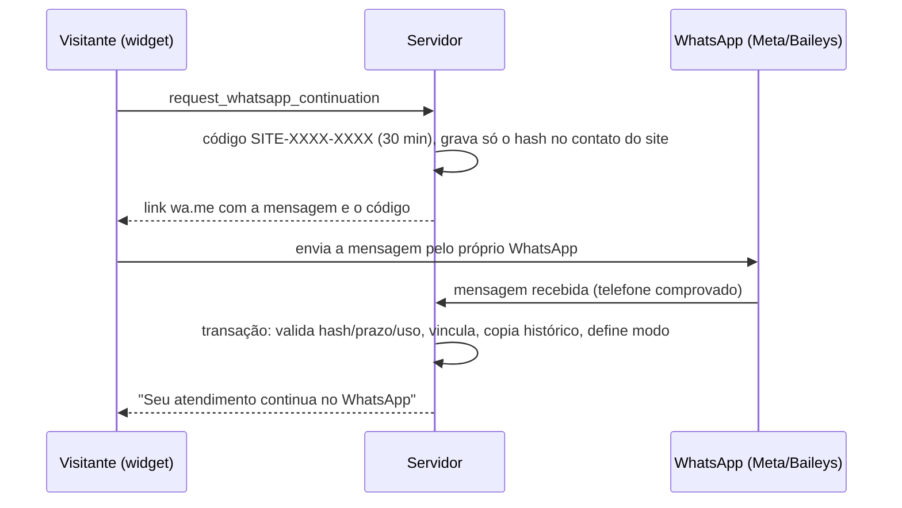

# Continuidade segura site → WhatsApp (E4)

Data: 20/10/2026. Continuação do [canal Site no núcleo](./IMPLEMENTACAO-SITE-NUCLEO-2026-10-20.md) e da etapa E4 do [mapa do porte](./MAPA-PORTE-FAGNER-2026-10-20.md).

Critério de saída do mapa: *Site → WhatsApp continua sem repetir dados, sem expor histórico indevido e sem consumir novo rodízio.* Vale somente para o perfil industrial (Tecfag). Valem mantém o link estático de WhatsApp no widget e nenhum caminho dela foi alterado.

## Fluxo

## Por que é seguro

- **Duas provas:** o código só existe no widget daquele visitante (posse da sessão do site) e chega por uma mensagem enviada do telefone do cliente (posse do número). Telefone digitado no site nunca vincula nada.
- **Uso único e prazo:** 30 minutos; um novo pedido substitui o anterior; após o uso, o código não vale mais.
- **Só hash no banco:** `contacts.customFields.siteContinuity.codeHash` = SHA-256 de tenant + código. O hash depende do tenant: código de uma empresa não funciona em outra.
- **Transação com lock** por código; contato, conversas e fluxos são bloqueados antes da alteração. Todas as consultas filtram `tenantId`.

## O que acontece no vínculo

1. **Histórico:** até 200 mensagens do site (não internas) são copiadas para a conversa do WhatsApp com o horário original, interpretação de mídia e referência à origem (`metaDetails.copiedFrom`). A cópia é idempotente.
2. **Identidade:** nome do site substitui nome genérico do WhatsApp (telefone/“Contato WhatsApp”); CPF/CNPJ são copiados se o contato do WhatsApp não tiver. Os dois contatos registram o vínculo.
3. **Com responsável humano no site** (`meus` com operador): a conversa do WhatsApp vai para **o mesmo operador e setor**, sem rodízio, e herda os cards vinculados (`crm_conversation_deals`). A IA não responde a essa mensagem. Se o WhatsApp já tinha responsável, ele é mantido.
4. **Triagem ainda com a IA:** o ciclo do WhatsApp recebe os **dados coletados** e o estado da triagem do site (sem checkpoint, recibo ou responsável do ciclo anterior) e começa no início do ciclo do site — o Fagner enxerga o histórico, não repete perguntas e não se reapresenta. Ciclos anteriores do WhatsApp ficam em `previousTriages`.
5. **Site encerrado:** o fluxo do site vira `completed` (“Continuado no WhatsApp”) e a conversa do site vai para `finalizados`. Se o visitante voltar a escrever no site, abre-se um novo ciclo normalmente.
6. **Rastreabilidade:** nota interna nas duas conversas; painel atualizado via SSE; widget recebe a confirmação.

No Baileys o vínculo roda logo após a transação da mensagem (para não disputar lock da conversa); o atraso de 15 s do agrupador garante que a triagem já encontre o ciclo vinculado.

## Configuração

Em **Configurações → Live Chat (Site)**, cartão **Atendimento do Fagner no site**: além de habilitar o canal e as origens, informe o **WhatsApp para continuar o atendimento** (DDI + DDD + número). Sem número, o widget informa que a continuação não está disponível.

O widget do Fagner (`public/site-chat.iife.js`, regenerado) troca o ícone de WhatsApp por um botão que pede o código; a aba do WhatsApp é aberta no próprio clique (evita bloqueio de pop-up) e o chat mostra o código e um botão “Abrir WhatsApp” (aceita apenas links `https://wa.me/`).

## Validação

- `npm run test:triage`: suíte completa aprovada (11 novos testes de continuidade: formato e extração do código, hash por tenant, link, limpeza do ciclo anterior e contratos do vínculo/entradas/widget).
- `npm run build` e checagem de tipos sem diagnósticos novos.
- **Não executado:** teste ponta a ponta com WhatsApp real e banco. O tenant Tecfag ainda não está em operação (a operação usa o sistema legado), então a homologação pode ser feita diretamente no ambiente do Tecfag Chat.

## Roteiro de homologação sugerido

1. Configurar destinos em Fluxos, habilitar SDR e o canal do site com o número do WhatsApp de teste.
2. Abrir o widget, iniciar triagem (ex.: interesse em seladora), informar nome e documento.
3. Clicar em “Continuar no WhatsApp”, enviar a mensagem: conferir histórico copiado, ausência de nova saudação e continuidade das perguntas.
4. Repetir com a conversa do site já transferida a um operador: conferir que o WhatsApp vai ao mesmo operador com o mesmo card e sem novo rodízio.
5. Reenviar o mesmo código e enviar código expirado: nada deve ser vinculado.
