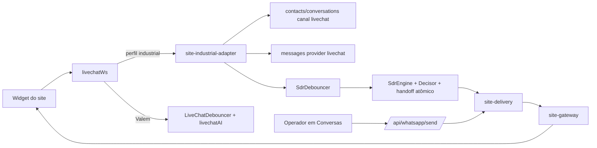

# Canal Site no núcleo de triagem industrial (E3)

Data: 20/10/2026. Continuação de [catálogo, Decisor e destinos por ID](./IMPLEMENTACAO-CATALOGO-DESTINOS-2026-10-20.md) e da etapa E3 do [mapa do porte](./MAPA-PORTE-FAGNER-2026-10-20.md).

Este lote conecta o widget do site ao **mesmo atendimento** do WhatsApp no perfil industrial (Tecfag). Não implementa a continuidade site ↔ WhatsApp (E4). Não houve deploy, alteração de configuração operacional, habilitação do canal ou acesso ao banco de produção. O caminho da Valem no site (Valentina, `livechatAI`, `LiveChatDebouncer`, saudação proativa, Tray) permanece inalterado.

## Como funciona

1. **Conexão.** O tenant informado pelo widget precisa existir no servidor; tenant desconhecido é recusado. No perfil industrial o visitante só conecta quando `agentConfigs` (tipo `sdr`) está habilitado **e** `config.siteChannelEnabled === true`. Se `config.siteAllowedOrigins` tiver itens, o cabeçalho `Origin` precisa coincidir (scheme + host + porta). O canal fica **desligado por padrão**.
2. **Identidade.** O visitante é resolvido por tenant + cookie. Na primeira mensagem são criados o contato `cont-lc-<visitante>` (canal `livechat`) e a conversa `conv-lc-<visitante>` na fila `automacao`. O pré-chat atualiza nome e guarda CPF/CNPJ apenas com dígitos verificadores válidos. Telefone digitado no site **não** é vinculado (posse não verificada — base para E4).
3. **Mensagens.** Texto, áudio, foto e PDF do visitante são gravados em `messages` (`provider: livechat`, ID determinístico a partir do ID do widget) e notificados ao painel. Com a conversa em automação e sem responsável, seguem para o mesmo `SdrDebouncer` → `SdrEngine` do WhatsApp: mesma política de 13 subfluxos, coleta por intenção, Decisor/catálogo e transferência transacional com card e rodízio. Vídeos e outros formatos ficam visíveis ao operador, sem envio do binário à IA. A confirmação ao widget só sai depois desse registro; reenvio com o mesmo ID é idempotente.
4. **Respostas do Fagner.** Para conversas `conv-lc-*` do perfil industrial, o motor entrega os balões pelo widget (com indicador de digitação e cancelamento por nova mensagem) e revalida a posse antes de cada balão. Áudio PTT vira texto (sem ElevenLabs). Fotos do catálogo vão como `send_image` e também ficam em `mediaFiles` para o operador.
5. **Operador.** O atendimento humano acontece no módulo de Conversas: `/api/whatsapp/send` aplica as mesmas validações (sessão, tenant, posse `meus`, card) e, para contato `livechat`, entrega o texto no widget. Anexos e templates Meta são recusados com `SITE_TEXT_ONLY`. As ações do painel LiveChat antigo (`take_over`, `operator_message` etc.) retornam `USE_CONVERSATIONS` no perfil industrial — há um único controle de posse.
6. **Transferência.** No handoff, contato `livechat` não depende da whitelist de telefone, mas exige `siteChannelEnabled` ainda ativo dentro da transação; se o canal for desligado durante a pendência, aplica-se recuo de 15 minutos no worker.
7. **Reabertura.** Mensagem em conversa finalizada abre novo ciclo de triagem, arquivando os ciclos anteriores em `metadata.previousTriages`.

## Correções de segurança no WebSocket (B09/B10)

- Tenant desconhecido e `cookieId` acima de 200 caracteres são recusados (vale para todos os tenants).
- `take_over`, `operator_message`, `release_to_ai` e `close_chat` verificam que o chat pertence ao tenant da sessão do operador antes de qualquer leitura/escrita, e usam o `visitorId` do banco em vez do enviado pelo cliente (vale também para a Valem).
- Fechar uma segunda aba do mesmo visitante não remove mais a conexão ativa da primeira.

## Widget com a identidade do tenant

O widget (`valem-widget/src/widget.ts`) tinha Valentina/Valem fixos em todo o HTML e uma saudação local "Eu sou a Valentina". Agora a identidade vem de um mapa por tenant:

- **Valem:** textos, número de WhatsApp, chaves de `localStorage`, saudação local e documento obrigatório idênticos aos atuais.
- **Tecfag:** Fagner / Grupo Tecfag, avatar servido pelo backend do chat, sem número de WhatsApp herdado, CPF/CNPJ **opcional** no pré-chat (assistência técnica não exige documento) e **sem saudação local** — a apresentação é feita pelo núcleo na primeira mensagem, evitando saudação duplicada.
- Recusa definitiva do servidor (código 1008) não gera reconexão infinita.

O bundle do Fagner é gerado separadamente como `public/site-chat.iife.js` / `site-chat.css` (`WIDGET_BUNDLE=site-chat npx vite build` em `valem-widget`). **O arquivo `valem-chat.iife.js` publicado no site da Valem não foi regenerado nem alterado.** O snippet em **Configurações → Live Chat (Site)** aponta para `site-chat` no perfil industrial e mantém `valem-chat` para a Valem.

## Configuração para homologação

Em **Configurações → Live Chat (Site)**, o perfil industrial exibe o cartão **Atendimento do Fagner no site** (somente administradores): liga/desliga o canal e define as origens autorizadas. A rota `GET/POST /api/valentina/site-channel` exige sessão de administrador e perfil industrial, grava apenas `siteChannelEnabled` e `siteAllowedOrigins` dentro da configuração SDR existente, preserva os demais campos e **não cria nem ativa o SDR** (sem configuração SDR retorna 409).

Os destinos de Fluxos (lote anterior) continuam obrigatórios para a transferência. Nenhuma configuração foi gravada nesta entrega.

## Validação

- `npm run test:triage` — **145 testes aprovados em 11 suítes** (20 novos do canal Site: regras puras, contratos de integração, rota de habilitação e identidade do widget). Os testes não abrem WebSocket, não chamam IA e não acessam banco.
- `npm run build` (Vite/Nitro) aprovado, incluindo a nova rota no `routeTree`.
- Checagem global de TypeScript: sem diagnósticos nos arquivos deste lote; os 34 erros pré-existentes em outros módulos permanecem.

## Limites conhecidos

- Não há teste ponta a ponta com widget real, banco e IA; a homologação manual em ambiente separado é obrigatória antes de habilitar o canal.
- Fotos do catálogo usam a URL pública `/knowledge-media/...` (mesmo mecanismo da Valem); se o arquivo não existir no disco do servidor, a imagem não carrega no widget.
- Operador envia apenas texto ao site. Envio de anexos exige rota pública de mídia autorizada por visitante.
- O pré-chat atualiza o contato, mas não preenche automaticamente os campos coletados pela triagem; o Fagner pode confirmar o documento na conversa.
- O widget não recebe aviso explícito quando um operador assume pela tela de Conversas; o cliente vê a mensagem de transferência do Fagner e, depois, as respostas do operador.
- E4 (vínculo seguro site → WhatsApp com token temporário, preservando ciclo, card e responsável) continua pendente.
