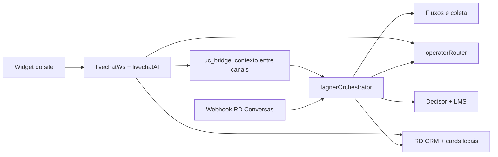
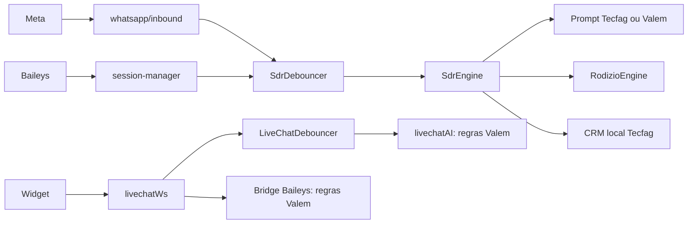
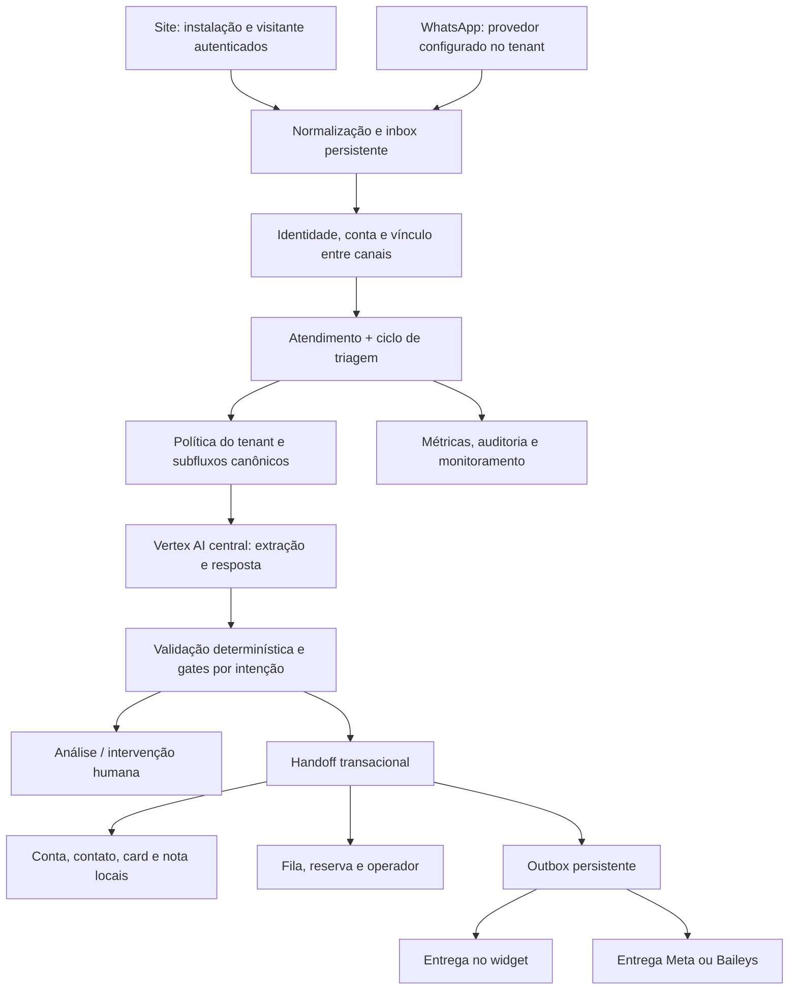
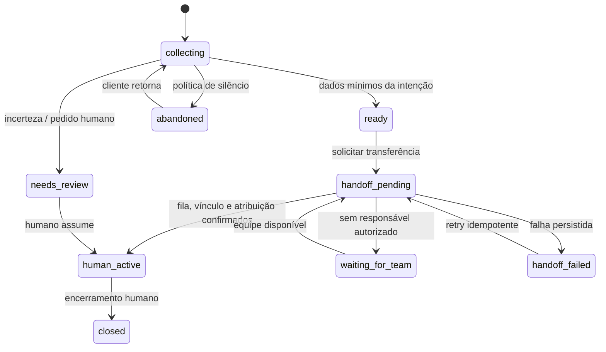

# Porte do Fagner: Site + Conversas → Tecfag Chat

Data: 20/10/2026. Entrega: diagnóstico de código, inventário funcional, evidências reproduzíveis e plano de implementação. **O porte operacional ainda não está concluído.**

Atualização: o [primeiro lote do núcleo industrial](./IMPLEMENTACAO-NUCLEO-TRIAGEM-2026-10-20.md) foi implementado após este diagnóstico. As constatações abaixo registram o estado inicial; o resumo da implementação distingue correções e pendências atuais.

Continuação: [handoff atômico e recuperação](./IMPLEMENTACAO-HANDOFF-ATOMICO-2026-10-20.md) e [catálogo, Decisor e destinos por ID](./IMPLEMENTACAO-CATALOGO-DESTINOS-2026-10-20.md) implementados em seguida. Site, continuidade entre canais e homologação operacional permanecem pendentes.

## 1. Decisões e alcance

Decisões confirmadas pelo usuário nesta análise:

1. Fagner Site e Fagner Conversas passam a formar um único atendimento.
2. O cliente pode ser atendido no próprio site e continuar no WhatsApp com o contexto preservado.
3. O CRM local é o destino oficial da triagem.
4. Os encaminhamentos do RD Conversas serão substituídos pelo atendimento nativo do Tecfag Chat.
5. RD Marketing continua separado; sua integração não deve ser removida com o RD CRM/Conversas.

Origem: `C:/Users/TEC FAG/Music/PROGRAMAÇÃO/PROJETOS/LOCAL/Tecfag I.A Faggner`, HEAD `e6b96494fb9bf20b57d114b777449dee2dbcd9da`.

Destino: checkout atual `VALEM CHAT`, HEAD inicial `b5c1c24a84d2bb85e1cec4aad715ed2114da5ece`.

A análise leu fontes locais e executou apenas classificação determinística isolada. Não consultou bancos, credenciais, configurações salvas em produção, provedores, histórico real ou os serviços em operação. Portanto, “presente” significa encontrado no código; não significa homologado em produção. Configurações persistidas podem alterar o comportamento efetivo do legado. A versão publicada também precisa ser confrontada com este checkout antes da virada.

Esta entrega adiciona este documento, um auditor offline e seu resultado JSON. Não altera o funcionamento dos aplicativos nem ativa recursos.

## 2. Conclusão técnica

Há uma base aproveitável na v2: autenticação por sessão, persona central, SDR multimodal, agrupamento de mensagens, CRM local, rodízio, telas de Fluxos/SDR e infraestrutura de site. Não é necessário reconstruir o produto.

O principal trabalho é unificar as regras e a execução. Atualmente:

- O WhatsApp usa `SdrEngine`, `SdrDebouncer` e `agent_flow_states`.
- O site usa `livechatAI`, `LiveChatDebouncer`, `lc_chats` e `lc_messages`, com prompt ainda específico da Valem.
- O vínculo site → WhatsApp é um envio direto por Baileys, não uma continuidade completa da mesma triagem.
- O classificador Tecfag representa nove destinos, enquanto o legado distingue treze subfluxos, além das saídas de análise e intervenção humana.
- A conclusão de triagem, a seleção de operador, o card e o envio ao cliente não formam uma transição confiável única.

**Ter as mesmas colunas de Kanban não demonstra paridade do atendimento.** A paridade precisa incluir coleta por intenção, exceções, destino, estado persistido, card, proprietário, histórico e recuperação de falhas.

## 3. Caminhos existentes

### Legado



Já existe alguma unificação no legado: site e Conversas compartilham seleção de operadores e uma ponte de identidade/contexto. Isso deve ser preservado como capacidade, sem copiar os acoplamentos ao RD ou a normalização insegura por sufixo de telefone.

### V2 atual



Referências v2: `src/lib/whatsapp/inbound.ts:343`, `src/lib/baileys/session-manager.ts:1638`, `src/lib/valentina/sdr-engine.ts:144`, `src/lib/livechat/livechatDebouncer.ts:37`, `src/lib/livechat/livechatAI.ts:46`, `src/lib/livechat/livechat-bridge.ts:36`.

## 4. Inventário funcional — Fagner Conversas

Estados: **Base** = há implementação aproveitável na v2; **Parcial** = implementação com diferença ou integração incompleta; **Pendente** = equivalente não localizado nos caminhos revisados; **Reformular** = preservar a finalidade, trocar o mecanismo.

| ID  | Capacidade do legado                                                      | Origem principal                                                             | Situação e destino na v2                                                                                                                     |
| --- | ------------------------------------------------------------------------- | ---------------------------------------------------------------------------- | -------------------------------------------------------------------------------------------------------------------------------------------- |
| C01 | Receber mensagens, identificar contato e deduplicar eventos               | `server/fagner/fagnerOrchestrator.ts`, `rdConversasService.ts`               | Base: `whatsapp/inbound.ts`, adaptadores e mensagens locais. Substituir os IDs RD por identidades locais, preservando aliases externos.      |
| C02 | Pausar/retomar o bot e sincronizar intervenção humana                     | Orchestrator, `sessionManager.ts`, APIs em `server/index.ts`                 | Parcial: trava por operador/fila e ação `stop` existem. Precisam compor estado comum entre site e WhatsApp.                                  |
| C03 | Agrupar mensagens e reprocessar mensagens recebidas durante geração       | `debounceEngine.ts`, `processingLimiter.ts`                                  | Base: `sdr-debouncer.ts`. Timer/mutex em memória não comprovam coordenação entre processos.                                                  |
| C04 | Reconstruir sessão após reinício e recuperar mensagem pendente            | `sessionPersistence.ts`, `sessionReconstructor.ts`, `pendingMessageStore.ts` | Parcial: `sdr-recovery.ts`; chamada encontrada na reconexão Baileys. Homologar recuperação Meta e site sem depender desse evento.            |
| C05 | Cinco famílias e treze subfluxos                                          | `routingConfig.ts`, `flowEngine.ts`                                          | Parcial: `sdr-tecfag-prompt.ts` tem nove destinos, sem equivalentes específicos para financeiro geral e três saídas de Outros.               |
| C06 | Coleta diferente para comercial, peças, suporte e financeiro              | `systemPrompt.ts:185`, gates no Orchestrator                                 | Parcial: campos genéricos e um gate de dados vitais para todas as intenções na v2.                                                           |
| C07 | Extrair vários dados de uma mensagem sem perguntar novamente              | Prompt + sessão persistida                                                   | Base: `collectedData` e histórico. Validar as regras por fluxo, inclusive primeira mensagem rica e mudança de assunto.                       |
| C08 | Validar CNPJ e enriquecer razão social/atividade/endereço                 | `cnpjService.ts`                                                             | Base: `valentina/cnpj-service.ts` e sincronização com contatos. Distinguir documento inválido de API indisponível e integrar à conta do CRM. |
| C09 | Aceitar CPF sem tratar como CNPJ                                          | Sessão, prompt, CRM                                                          | Parcial: v2 aceita 11 dígitos; o gate lido não valida CPF matematicamente. Não confundir “tem 11 dígitos” com “documento confirmado”.        |
| C10 | Decisor de linha por categoria, catálogo, capacidade e confiança          | `decisorService.ts:90`                                                       | Pendente: não localizado equivalente conectado ao SDR. Evitar decidir Personnalité por uma palavra do anúncio.                               |
| C11 | LMS por dados cadastrais/porte e enriquecimento opcional                  | `lmsService.ts:26`, `bigdatacorpService.ts`                                  | Pendente: CNPJ existe, mas não equivale ao LMS. Separar dados observados de estimativas e de decisões comerciais.                            |
| C12 | Fila Análise para classificação incerta e revisão SDR humana              | `flowEngine.ts`, Orchestrator                                                | Parcial: não há estado equivalente explícito no contrato de nove destinos. “Outros” não substitui análise.                                   |
| C13 | Pedido de humano, de pessoa específica e frustração                       | `geminiService.ts:116`, Orchestrator `:2432`, `:2525`                        | Pendente como política Tecfag comum: transferência não deve exigir qualificação comercial completa.                                          |
| C14 | Escala por subfluxos autorizados, disponibilidade e compensação           | `shared/operatorRouter.ts:32`                                                | Parcial: `rodizio-engine.ts:1264`. A v2 permite fallback para operadores gerais e usa escrita de JSON sem lock da seleção.                   |
| C15 | Reserva idempotente, confirmação e cancelamento de atribuição             | `livechat/siteRotationService.ts` e router compartilhado                     | Pendente como contrato comum entre canais e CRM. Um lead deve consumir uma única atribuição.                                                 |
| C16 | Procurar/criar card, associar contato/empresa, responsável, tarefa e nota | `fagner/rdCrmService.ts`                                                     | Reformular: reaproveitar CRM local e política explícita por subfluxo. Não transportar endpoints/IDs RD.                                      |
| C17 | Não gerar negociação em certos fluxos administrativos                     | `fagner/rdCrmService.ts:2191`                                                | Pendente: v2 tenta garantir card ao concluir qualquer triagem Tecfag. Separar atendimento, solicitação e oportunidade comercial.             |
| C18 | Relatório final e notas progressivas com dados e evidências               | `reportService.ts`, Orchestrator, serviços CRM                               | Parcial: resumo local de triagem existe; notas progressivas, justificativa de classificação e handoff precisam ser unificados.               |
| C19 | Áudio, imagem, documento, memória de interpretação e retry de mídia       | `mediaService.ts`, filas/polling no Orchestrator                             | Base: partes multimodais e `mediaInterpretation`; homologar cada canal e não copiar polling RD desnecessário.                                |
| C20 | Catálogo de máquinas e famílias não atendidas                             | `decisorService.ts`, `machineGroups.json`, `machine_catalog`                 | Parcial: base de conhecimento e CRM products/catalogs não equivalem automaticamente ao catálogo decisório industrial.                        |
| C21 | Follow-up após silêncio, interrupção por humano e retorno do cliente      | `followUpService.ts`                                                         | Pendente para Tecfag: engine novo lido é fixo Valem e tem outra régua.                                                                       |
| C22 | Fechamento diário de Sem Resposta e relatório                             | `noResponseService.ts`                                                       | Pendente como execução Tecfag; coluna visual não comprova job.                                                                               |
| C23 | Horário de equipe e mensagem fora de expediente                           | `scheduleService.ts`                                                         | Pendente como política comum por tenant/setor. IA e expediente humano são controles distintos.                                               |
| C24 | Score comercial em cinco dimensões                                        | Orchestrator `:936`, `:969`                                                  | Pendente no SDR revisado; temperatura/score de navegação não são esse score.                                                                 |
| C25 | Campanha de origem e notificação operacional                              | `emailNotificationService.ts`                                                | Reformular com eventos locais e RD Marketing separado; não copiar destinatários reais fixos.                                                 |
| C26 | Terminal, sessão detalhada, dados capturados, histórico e simulação       | `Dashboard.tsx`, `LiveMonitor.tsx`, `FlowMonitor.tsx`, APIs bot/sessions     | Parcial: `SdrTab`, `RodizioTab`, `FluxosTab` e monitor existem; simulação isolada e trilha causal ainda precisam compor o núcleo.            |
| C27 | Controle de custo, limite de concorrência, retry e circuit breaker        | `geminiService.ts`, `processingLimiter.ts`, `apiCosts`                       | Parcial: Vertex central + `aiUsageLogs` existem; dimensionar filas e concorrência compartilhada sem importar fallback de outros provedores.  |

## 5. Inventário funcional — Fagner Site

| ID  | Capacidade do legado                                                  | Origem principal                                             | Situação e destino na v2                                                                                                                |
| --- | --------------------------------------------------------------------- | ------------------------------------------------------------ | --------------------------------------------------------------------------------------------------------------------------------------- |
| S01 | Widget, visitante por cookie, sessão, histórico e reconexão           | `chat-widget-pro`, `livechatWs.ts`                           | Base: `valem-widget`, `livechatWs`, `livechatStorage`; revisar branding e contrato público para Tecfag.                                 |
| S02 | Página atual, pageviews, tempo, scroll, cliques, origem e UTM         | `livechatIntentResolver.ts`, `livechatScoring.ts`, WebSocket | Parcial: tabelas/pageviews/scoring existem, mas confirmar campos e consumo no atendimento comum.                                        |
| S03 | Abordagem proativa conforme página e atividade                        | `generateProactiveMessage`, timers WS                        | Parcial: `generateProactiveGreeting` existe, ainda com regras Valem; respeitar configuração/horário de abordagem.                       |
| S04 | Consulta de produto a partir de botão da página                       | evento `PRODUCT_INQUIRY`, contexto VTEX                      | Pendente no contrato unificado; transportar produto/categoria/URL como evidência, sem adivinhar intenção.                               |
| S05 | Busca VTEX, sinônimos e especificações verificadas                    | `livechat/vtexCatalogService.ts`, `fagner/vtexService.ts`    | Pendente no site v2 revisado, que usa Tray. VTEX Tecfag e Tray Valem devem ser capacidades configuradas por tenant.                     |
| S06 | Preço público, frete e links de produto/compra, conforme regras       | `livechatAI.ts:827`, `vtexCheckoutService.ts`                | Reformular: política explícita. Site legado permite informação de produto em situações em que o SDR WhatsApp proíbe preço/modelos.      |
| S07 | Fluxos de Máquinas, Peças, Pós-Venda e Outros                         | `livechatAI.ts`, `livechatWs.ts`                             | Parcial: motor novo é Valem/atacado, não porte do atendimento industrial Tecfag.                                                        |
| S08 | Coleta específica, resumo/overview e confirmação                      | prompt Site e campos `maquina*`, `pecas*`, `posVenda*`       | Pendente na modelagem comum; eliminar campos duplicados por canal sem perder o conteúdo histórico.                                      |
| S09 | Entrega ao operador no próprio widget e retorno à IA                  | `TAKE_OVER`, `RETURN_TO_AI`, `AGENT_MESSAGE`                 | Base no backend v2: `take_over`, `release_to_ai`, `operator_message`; integrar ao controle humano único e validar posse/tenant dos IDs. |
| S10 | Marcador de atenção, necessidade humana, arquivo, reabertura e motivo | `LiveChat.tsx`, `livechatRoutes.ts`, WS                      | Parcial: status/fechamento existem; não foi demonstrada paridade completa de atenção, motivos e retorno.                                |
| S11 | Continuidade entre canais e perfil único                              | `unified/contactBridge.ts:128`, `:361`                       | Pendente: bridge v2 envia WhatsApp, mas não transfere estado completo de triagem; modelo de contatos/contas local é a base.             |
| S12 | CRM automático por fluxo, resumo e operador reservado                 | `siteRotationService`, serviços RD                           | Reformular usando o mesmo serviço de handoff/CRM do WhatsApp; sem segundo rodízio.                                                      |
| S13 | Resgate de lead parcial após inatividade                              | timers de 5 e 10 minutos em `livechatWs.ts:159`, `:366`      | Pendente. Registrar dados incompletos; silêncio não deve virar confirmação fictícia.                                                    |
| S14 | Notas progressivas, resumo final, briefing e timeline                 | `livechatAI.ts:1667`, `:1765`, rotas timeline/briefing       | Parcial: histórico e RAG existem; falta equivalência comum de notas e evidências vinculadas ao atendimento.                             |
| S15 | Score de navegação, temperatura e detecção de retorno                 | `livechatScoring.ts`, WS                                     | Parcial: v2 tem score, mas calibrado para atacado Valem (CNPJ/1.000 unidades). Não usar para classificar porte industrial.              |
| S16 | Avaliação em estrelas/NPS e fechamento sem venda/com venda            | `NPS_RATING`, outcomes Site                                  | Pendente de equivalência no site v2 revisado. Avaliação coletada e venda confirmada são eventos diferentes.                             |
| S17 | Métricas de ativação, contenção, latência, intenções, coortes e funil | `livechatRoutes.ts:718` em diante, componentes dashboard     | Parcial: v2 possui analytics, mas métricas precisam usar o atendimento comum e definições comparáveis.                                  |
| S18 | Anexos do visitante e operador, notificações e presença               | WS, upload, frontend                                         | Parcial: recebimento multimodal existe; validar limites, armazenamento, autorização, entrega e contexto por canal.                      |
| S19 | Conversão/pedido VTEX por webhook                                     | `server/index.ts` e `/api/livechat/vtex-order-hook`          | Pendente no caminho Tecfag novo. Pedido confirmado deve vir de evento verificável, não da fala do LLM.                                  |
| S20 | Exportações e relatórios de atendimento                               | `livechatRoutes.ts` e painel Site                            | Parcial: ferramentas locais/analytics a inventariar por contrato de exportação; não copiar geração RD como dependência.                 |

## 6. Subfluxos e coleta que precisam sobreviver ao porte

O código canônico legado tem **13 subfluxos**. O Kanban pode continuar compacto, mas deve projetar subfluxos estáveis. Rótulos visuais não devem ser chaves de roteamento.

| Código legado  | Finalidade                                               | Coleta/política observada em Conversas                                                                               | Equivalente v2 atual / lacuna                                    |
| -------------- | -------------------------------------------------------- | -------------------------------------------------------------------------------------------------------------------- | ---------------------------------------------------------------- |
| `MAQUINAS`     | Compra de equipamento                                    | Nome + documento; perguntar processo/produto e volume sem repetir dados; decidir linha por evidências                | Máquinas; coleta comercial precisa de gates próprios             |
| `PERSONNALITE` | Linha industrial de maior desempenho                     | Decisor/catálogo/porte; revisão em Análise conforme condições; não equivale a embalagem personalizada                | Personnalité existe com significado errado no prompt             |
| `PECAS`        | Reposição e consumíveis                                  | Nome + documento; identificar a peça; não exigir série/foto/origem se cliente não mencionou incompatibilidade        | Peças; prompt novo sugere modelo/série genericamente             |
| `2A_BOLETO`    | Boleto/cobrança                                          | Nome + documento + necessidade; não pedir série/modelo ou número de pedido como gate geral                           | Fin. Boleto                                                      |
| `2B_NF`        | Documento fiscal financeiro                              | Documento + necessidade; distinguir NF de pedido existente                                                           | Fin. Nota Fiscal; reconhecimento local incompleto                |
| `2C_OUTROS`    | Financeiro geral/estorno                                 | Entender demanda; `upsertDeal` não gera card                                                                         | Ausente; não substituir por Fin. Boleto                          |
| `3_AT`         | Defeito, manutenção, manual/esquema                      | Nome + solicitação; perguntar modelo uma vez se necessário, sem bloquear; não pedir CNPJ/CPF/série/etiqueta          | Assistência Técnica; gate novo exige documento ou empresa        |
| `4A_RASTREAR`  | Entrega/rastreio                                         | Nome + documento; pedido/proposta quando disponível; sem questionário comercial                                      | Pós-Venda Rastreio                                               |
| `4B_NF`        | NF relacionada ao pedido                                 | Contexto de compra/pedido; equipe Pós-Venda                                                                          | Pós-Venda - NF do Pedido                                         |
| `POS_VENDA`    | Devolução/cancelamento ainda a realizar e demais pedidos | Distinguir de dinheiro de volta após devolução; não enviar manuais aqui                                              | Pós-Venda Geral; devolução não reconhecida pelo resolver simples |
| `5A_CLIENTE`   | Pessoa/equipe específica e atendimento geral             | Intervenção humana sem obrigar qualificação de compra; política de card tem divergência entre prompt e implementação | Apenas Outros, com destino comercial como fallback               |
| `5B_CURRICULO` | Currículo/vagas                                          | Orientação e encerramento; sem card comercial                                                                        | Sem subfluxo próprio                                             |
| `5C_COMPRAS`   | Fornecedor/parceria/compras internas                     | Orientação e encerramento; sem card comercial                                                                        | Sem subfluxo próprio                                             |

Fontes: legado `routingConfig.ts:56`, `systemPrompt.ts:185`, `:219`, `:239`, `:260`, `:289`; execução de exclusão de card em `rdCrmService.ts:2191`. V2: `sdr-tecfag-prompt.ts:27`, `:207`, `:219`, `sdr-engine.ts:908`.

### Regras de precedência

- “Boleto da seladora” é financeiro; a máquina é contexto.
- “Manual da seladora” é assistência; “seladora manual” pode ser intenção comercial. Preservar a distinção.
- “Quero devolver” é Pós-Venda; “estorno da máquina que devolvi” é Financeiro.
- NF com contexto de pedido e NF financeira precisam de destinos distintos.
- Manutenção de equipamento Personnalité continua assistência técnica; a linha não sobrepõe a intenção.
- Mensagem de campanha com “Personnalité” não comprova necessidade/capacidade/porte nem conclui a triagem.
- Solicitação de pessoa/humano deve admitir intervenção sem os gates de uma venda.
- Troca de assunto deve atualizar intenção sem apagar identidade, histórico ou criar transferência do assunto anterior.
- Incerteza deve gerar revisão/Análise, nunca Máquinas por falta de alternativa.

### Conflitos do próprio legado

O legado não é um oráculo perfeito a copiar:

1. O prompt Site agrupa defeito, boleto, garantia e visita em Pós-Venda; Conversas separa essas áreas. A versão unificada deve usar a intenção específica e manter o canal como contexto.
2. O Site permite informações técnicas/preço público conforme VTEX; o SDR Conversas proíbe valores/modelos e checkout. Centralizar uma política de capacidades; manter o fluxo de triagem único, com consulta informativa controlada quando autorizada pela configuração.
3. O LMS faz heurísticas e menciona promoção por capital ≥ R$ 350 mil; o Decisor também define precedência por categoria/capacidade e revisão. Não tornar o valor isolado uma decisão definitiva sem consolidar a ordem das regras.
4. `2C_OUTROS`, currículo e compras não criam card na execução de `upsertDeal`. Para `5A_CLIENTE`, o prompt fala em não criar card, mas essa exclusão não está no mesmo guard. Definir uma política única, em vez de reproduzir a contradição.
5. A regra de reuso do legado busca card ativo no funil SDR, salvo vínculo explícito em sessão. A v2 usa criação nas últimas três horas. Não são regras equivalentes.
6. Site tem fechamento por silêncio com confirmação presumida em alguns caminhos. Preservar o resgate do lead, registrando dados incompletos e ausência de confirmação.
7. O bridge legado consulta telefone por últimos nove dígitos em um caminho. Não copiar esse critério para vínculo automático de pessoas.
8. Serasa e Cenprot possuem serviços declaradamente mock. Existência do arquivo não comprova consulta real de crédito/protestos nem seu uso efetivo na versão publicada.

Esses pontos exigem contratos de negócio e testes, não a cópia literal de prompts extensos.

## 7. Evidência offline de divergências

Auditor: [`scripts/audit-fagner-triage-parity.mjs`](../scripts/audit-fagner-triage-parity.mjs).

Resultado: [`fagner-triage-parity-2026-10-20.json`](./fagner-triage-parity-2026-10-20.json).

Executado com TypeScript local, sem importar banco, .env ou módulos de servidor com efeitos externos. Dependências de seleção de operador são bloqueadas. O resultado guarda hashes SHA-256 dos três módulos exercitados.

**20 cenários: 9 com a mesma coluna e 11 com coluna diferente; mais 4 casos de metadados.** Essa amostra é dirigida a riscos, não é uma amostragem estatística. Não representa taxa de acerto em produção. O legado recebe texto bruto no fallback; a v2 recebe esse texto no campo de interesse, que normalmente pode ser extraído/resumido pelo LLM. O teste revela o comportamento local do pós-processamento e seus defaults, não o resultado de conversas completas.

| Entrada sintética                             | Classificador local legado                | Resolver local v2         |
| --------------------------------------------- | ----------------------------------------- | ------------------------- |
| Quero ver soluções Personnalité               | Máquinas, antes da classificação de linha | Personnalité direto       |
| Quero cotar ribbon                            | Peças                                     | Triagem, destino Máquinas |
| Preciso de ink roll                           | Peças                                     | Triagem, destino Máquinas |
| Preciso da segunda via da nota fiscal         | Financeiro                                | Triagem, destino Máquinas |
| Quero saber do estorno da máquina que devolvi | Financeiro                                | Máquinas                  |
| Preciso de reembolso                          | Financeiro                                | Triagem, destino Máquinas |
| Preciso do manual da seladora                 | Assistência Técnica                       | Máquinas                  |
| Pode enviar o esquema elétrico da máquina?    | Assistência Técnica                       | Máquinas                  |
| Preciso de manutenção na máquina Personnalité | Assistência Técnica                       | Personnalité              |
| Preciso da nota fiscal do pedido              | Pós-Venda                                 | Triagem, destino Máquinas |
| Quero devolver a máquina                      | Pós-Venda                                 | Máquinas                  |

Casos extras: Outros e Sem Resposta retornam `targetFunnel: "Máquinas"`; estágio existente desconhecido é preservado por cast; um destino Peças pode ser sobreposto pela menção a máquina Personnalité no interesse.

Mesmo os nove casos com a mesma coluna não comprovam paridade de subfluxo, coleta, elegibilidade, card ou transferência. Currículo e fornecedor, por exemplo, caem em Outros nas duas versões, mas o destino da v2 ainda aponta para Máquinas.

Reexecutar no PowerShell:

```powershell
node scripts/audit-fagner-triage-parity.mjs --legacy-root 'C:\Users\TEC FAG\Music\PROGRAMAÇÃO\PROJETOS\LOCAL\Tecfag I.A Faggner'
```

Para gerar nova evidência, usar `--out docs/<novo-nome>.json`. O script não sobrescreve evidência existente. `--check-parity` retorna 1 quando há diferença de coluna; sem a opção, é um relatório e retorna 0 mesmo com diferenças.

## 8. Bloqueadores encontrados na v2

| ID  | Prioridade | Constatação e evidência                                                                                                                            | Correção necessária / aceite                                                                                                                                                     |
| --- | ---------- | -------------------------------------------------------------------------------------------------------------------------------------------------- | -------------------------------------------------------------------------------------------------------------------------------------------------------------------------------- |
| B01 | P0         | Site usa nome/empresa/regras Valem em `livechatAI.ts:46`, `:78`, `:135`; bridge repete persona em `livechat-bridge.ts:72`                          | Persona via `getAiPersona(tenantId)` e política carregada do tenant. Testar site Tecfag sem texto Valem e vice-versa.                                                            |
| B02 | P0         | `sdr-tecfag-prompt.ts:208` descreve Personnalité como sachês/bobinas personalizadas; resolver dá prioridade lexical em `:69`                       | Portar conceito de linha industrial e Decisor com evidências; suporte/financeiro não podem virar venda Personnalité.                                                             |
| B03 | P0         | `sdr-engine.ts:908` exige nome + empresa/documento + produto para toda conclusão                                                                   | Gates por intenção, emergência e pedido humano; AT não pode travar por CNPJ.                                                                                                     |
| B04 | P0         | Falha de CRM/alocação é capturada em `sdr-engine.ts:1136`; conclusão em `:1212` depende de `isCompleted`, não do sucesso do handoff                | Separar “dados prontos” de “transferência confirmada”. Falha deve manter pendência recuperável, sem anunciar sucesso.                                                            |
| B05 | P0         | `rodizio-engine.ts:1301` recorre a operadores gerais quando falta correspondência                                                                  | Destino exato por subfluxo; falta de responsável gera fila correta/revisão. Nunca sortear vendedor para suporte/financeiro.                                                      |
| B06 | P0         | Seleção, atribuição e contador em `rodizio-engine.ts:1264` são operações separadas; JSON lido/reescrito                                            | Lock/transação por tenant/fila e registro idempotente por ciclo. Dois leads simultâneos não perdem contadores nem reservam duas vezes o mesmo ciclo.                             |
| B07 | P0         | `getRodizioState` pode salvar equipe de referência automaticamente em `rodizio-engine.ts:128`; SDR cria config `enabled: 1` em `sdr-engine.ts:199` | Consultas não devem semear nem habilitar operação. Configuração explícita, desligada por padrão para implantação.                                                                |
| B08 | P0         | `isSdrTenant` em `ai-persona.ts` habilita ambos os tenants conhecidos; Supervisor usa esse mesmo gate                                              | Separar existência de persona de habilitação operacional de cada recurso. Tecfag não deve herdar Supervisor/Auditorias por ter SDR.                                              |
| B09 | P0         | WebSocket visitante em `livechatWs.ts:74` aceita tenant/cookie e cria sessão sem validação explícita de instalação/domínio nesse caminho           | Resolver instalação pública autorizada no servidor; token de visitante e escopo/expiração; validar mensagens por sessão. Tenant informado pelo widget é seletor, não autoridade. |
| B10 | P0         | Operador WS valida sessão/tenant na conexão; `saveMessage` insere com `chatId` recebido, sem verificar o chat pai em `livechatStorage.ts:149`      | Verificar chat/visitante/permissão dentro do tenant antes de ler, escrever e assumir; integridade de referências no banco.                                                       |
| B11 | P0         | Persistência de `agentConfigs` no rodízio contém updates apenas por ID (`rodizio-engine.ts:213`, `:571`)                                           | Aplicar filtro explícito de tenant em cada escrita, mesmo após leitura filtrada. Não expandir essas operações ao novo fluxo sem corrigir.                                        |
| B12 | P1         | Nove destinos não representam os treze subfluxos; Outros/Sem Resposta usam Máquinas como destino                                                   | IDs canônicos, destino opcional para estados sem rota, revisão quando desconhecido.                                                                                              |
| B13 | P1         | `sdr-crm-local.ts:245` escolhe pipeline por texto e depois default/primeiro                                                                        | Mapeamento por IDs validados no tenant. Sem pipeline configurado, mostrar pendência operacional em vez de adivinhar.                                                             |
| B14 | P1         | Janela de três horas é diferente da política de card ativo no SDR do legado                                                                        | Especificar reuso por identidade, intenção, status e ciclo; manter vínculo manual e histórico. Não fundir assunto novo só porque é recente.                                      |
| B15 | P1         | `sdr-followup-engine.ts:19` é Valem fixo; régua 6/15/20 difere do legado Tecfag                                                                    | Política Tecfag configurável, persistência, cancelamento por humano e dedup por etapa/ciclo.                                                                                     |
| B16 | P1         | Recuperação SDR é chamada na reconexão Baileys (`session-manager.ts:469`)                                                                          | Worker comum para mensagens/transferências pendentes em Meta, Baileys e site.                                                                                                    |
| B17 | P1         | Histórico SDR usa ascendente + limite 80 (`sdr-engine.ts:287`)                                                                                     | Buscar as últimas mensagens e reordenar; testar ciclos com mais de 80 mensagens. Site tem consultas ascendentes limitadas semelhantes.                                           |
| B18 | P1         | `agents.ts` responde métricas fixas em `mockMetrics`                                                                                               | Derivar contagens/status reais ou exibir indisponível; não usar esses números como evidência de migração.                                                                        |
| B19 | P1         | `sdr-channel-sender.ts:32` decide provedor padrão pelo nome do tenant se configuração falhar                                                       | Canal deve ser resolvido por configuração validada; falta de configuração gera estado operacional explícito, sem envio por provedor presumido.                                   |
| B20 | P1         | Bridge direto Baileys não carrega ciclo, campos e card comuns                                                                                      | Continuidade por vínculo verificado/token curto, mantendo estado e contexto nos dois canais; respeitar políticas reais do provedor Meta.                                         |

P0 = resolver antes de liberar o fluxo unificado a clientes. P1 = implementar/homologar no porte antes de declarar paridade operacional. São achados dos caminhos revisados, não uma auditoria de segurança de todo o repositório.

### Regras do repositório que já divergem do código

O `AGENTS.md` descreve Tecfag apenas com chat interno e SDR/Supervisor/Auditorias desativados até go-live. O código atual permite SDR Tecfag e usa sua elegibilidade também no Supervisor. O documento também descreve a persona como TI, enquanto o código/persona e o legado são industriais. Essas divergências precisam ser formalizadas no plano de implantação; esta análise não altera o gate nem ativa o atendimento.

Não repetir achados antigos sem conferir: a busca de configuração SDR já filtra tenant em `sdr-engine.ts:185`; o Supervisor já percorre tenants e filtra as conversas no código atual. O problema revisado é o gate de recursos, não a antiga query global descrita no checklist histórico.

## 9. Arquitetura de destino

### Núcleo comum, adaptadores de canal



Os adaptadores cuidam de transporte, presença, anexos e autenticação do canal. Não decidem a classificação comercial nem criam card/rodízio independentemente. O núcleo pode preservar contextos específicos do site e capacidades de consulta de catálogo sem manter dois motores de negócio.

### Contratos propostos, ainda não implementados

| Contrato              | Responsabilidade e invariantes                                                                                                                                   |
| --------------------- | ---------------------------------------------------------------------------------------------------------------------------------------------------------------- |
| `InboundEvent`        | Tenant resolvido no servidor, canal/conta do canal, identificador externo, idempotência, texto, anexos e instante do evento.                                     |
| `Attendance`          | Atendimento rastreável que agrega canais vinculados com segurança. Identidade anônima é permitida no site.                                                       |
| `TriageCycle`         | Uma intenção/ciclo com campos, evidências, pendências, revisão, operador e resultado. Contato pode ter vários ciclos sem apagar histórico.                       |
| `TriagePolicy`        | Regras por tenant/subfluxo: campos mínimos, exceções, necessidade de card, filas, capacidades informativas e horário. Configuração versionada em `agentConfigs`. |
| `TriageDecision`      | Intenção/subfluxo, dados com origem/confiança, próxima pergunta ou ação; não inclui autorização autônoma do LLM para enviar/criar registros.                     |
| `HandoffResult`       | Resultado real: reservado, aguardando equipe, falha recuperável ou transferido; IDs locais e motivo. Só transferido após persistência confirmada.                |
| `Assignment`          | Reserva/consumo por tenant + ciclo + fila; confirmação/cancelamento explícitos; contagem auditável.                                                              |
| `ConversationContext` | Identidade, conta atual, contexto histórico da conta neste atendimento, dados confirmados, interesse atual, resumo e referências de mídia.                       |
| `OutboundEvent`       | Payload válido, canal de destino, idempotência, tentativas, status real e erro. Sucesso lógico de geração não equivale a mensagem entregue.                      |

A nomenclatura acima é proposta de contrato. Antes de criar tabelas, verificar o que pode ser representado por `conversations`, `agentFlowStates`, `crmConversationDeals`, eventos e envelopes existentes. Evitar um segundo CRM ou um segundo cadastro de contatos.

### Estado operacional



É possível mapear esses conceitos para estados existentes; não alterar enums em produção sem migração compatível. `ready`, `waiting_for_team` e `handoff_failed` não podem aparecer como transferência concluída no painel.

### Identidade e mudança de canal

- Reutilizar `contacts` para a pessoa/identidade e `crm_accounts` para comprador PF/PJ, conforme `docs/customer-identity-consolidation.md`.
- Cookie anônimo não prova posse de telefone. Digitar o telefone de outra pessoa não pode revelar histórico dela.
- Vínculo site → WhatsApp exige evidência de posse/continuidade, por token temporário ou mecanismo equivalente; não por últimos nove dígitos, nome parecido ou apenas CNPJ.
- Preservar origem do contato, origem desta sessão/ciclo e origem da negociação separadamente. Uma troca de canal não deve apagar atribuição de campanha.
- Levar campos confirmados, intenção, perguntas pendentes, resumo, mídias referenciadas e relação com card/operador. Não repetir o questionário.
- Manter contexto histórico de empresa por atendimento. A pessoa pode representar outra empresa depois, sem reescrever cards antigos.
- Mudar canal não consome novo rodízio. Mudar demanda pode abrir novo ciclo explicitamente, preservando o anterior.
- A mesma fila deve ser operável pelo atendente no site ou no WhatsApp, com um único controle de posse/intervenção humana.

## 10. IA, catálogo e conhecimento

1. Todas as chamadas de IA novas/portadas usam `src/lib/vertex-ai.ts`, Service Account e os parâmetros obrigatórios de custo `tenantId`, `feature` e IDs de rastreio. O mapa atual de features não define uma chave separada para SDR Tecfag; formalizar isso sem inventar uma nova chave fora do contrato do painel.
2. Não portar `llamaService` nem fallbacks Gemini por API key do legado. Preservar a resiliência dentro do serviço Vertex autorizado.
3. Centralizar prompt/regra por configuração versionada de tenant. A UI precisa mostrar a versão efetivamente usada pelo motor, permitir simulação e histórico; texto salvo sem consumidor não equivale a configuração operacional.
4. Decisor deve consultar catálogo real: categoria, modelo/SKU, linha, capacidade, unidade de produção e fonte. Não tratar descrição de subprocesso de uma empacotadora como outra categoria de máquina.
5. Separar `CNPJ facts`, `commercial classification`, `credit checks` e `lead score`. Capital não prova faturamento; estimativa não deve ser exibida como consulta real.
6. Regras de confiança abaixo do limiar enviam para Análise. Retorno inválido, família bloqueada, catálogo vazio e indisponibilidade precisam ter ações determinísticas.
7. Não usar serviços mock para afirmar ausência de protestos ou crédito aprovado. Serviços opcionais devem sinalizar não consultado/indisponível.
8. Reutilizar `knowledge-service.ts` com filtro de tenant e referências reais. Manuais, fotos e fichas devem ser identificáveis e autorizados para o canal.
9. Resposta sobre arquivo só pode usar conteúdo realmente lido; registrar transcrição/interpretação com a mídia de origem.
10. Definir a política de produto/preço antes de portar permissões divergentes do Site e Conversas. Checkout automático não é pré-requisito da triagem unificada.
11. Existem caminhos de áudio ElevenLabs no código novo, em conflito com a regra de fornecedor único para IA. Não estender esse mecanismo no porte; resolver a compatibilidade via serviço central sem alterar abruptamente os caminhos em uso da Valem.

## 11. Dados e integrações: de/para

| Origem                                                  | Destino preferencial                                    | Regra de migração                                                                                                              |
| ------------------------------------------------------- | ------------------------------------------------------- | ------------------------------------------------------------------------------------------------------------------------------ |
| Contato RD Conversas / sessão Fagner                    | `contacts`, aliases de canal, `conversations`           | Resolver tenant no importador; IDs externos como aliases, nunca autoridade de sessão interna.                                  |
| Cadastro/CPF/CNPJ no legado                             | `crm_accounts` + vínculo de pessoa                      | Deduplicar dentro do tenant; conflitos geram revisão. Não misturar pessoa e empresa pelo nome.                                 |
| `fagner_session_state`, `FlowData`, mídia e flags       | ciclo em `agentFlowStates` + contexto/eventos           | Preservar campos e origem, pausas, intervenção e intenção. Não importar como sessão ativa automaticamente.                     |
| `sessions`, mensagens e logs                            | histórico com fonte/ID antigo                           | Importação idempotente, ordenação por data e reconciliação de anexos; mensagens antigas não devem disparar IA.                 |
| `fc_cards`, dados de encaminhamento e notas             | CRM local + eventos de ciclo                            | Card de triagem e negociação comercial são conceitos diferentes. Não criar oportunidade para cada log ou saída administrativa. |
| `fc_operators_scale` e `allowed_subflows`               | operadores locais + política de fila                    | Mapeamento explícito; disponibilidade e compensações precisam de data de corte. Não cadastrar equipe por consulta GET.         |
| `site_lead_assignments`                                 | atribuições locais auditáveis                           | Preservar confirmação/reserva/cancelamento; não recontar lead já distribuído.                                                  |
| `lc_visitors`, `lc_chats`, `lc_messages`                | identidade/sessão site + atendimento comum              | Tabelas novas têm nomes semelhantes, mas contratos/campos não são equivalentes. Não copiar linhas às cegas.                    |
| `lc_pageviews`, eventos de navegação e `uc_bridge`      | histórico de navegação + vínculo seguro de atendimento  | Preservar origem/UTM e contexto; não importar vínculo por sufixo de telefone como fato confirmado.                             |
| `documents`, folders e arquivos                         | base de conhecimento por tenant                         | Copiar anexos e referências com verificação de existência, conteúdo e permissões.                                              |
| `machine_catalog`, famílias bloqueadas e sinônimos VTEX | catálogo decisório / configuração de catálogo           | Converter unidades/categorias e versionar. Catálogo do CRM não substitui isso sem os mesmos campos.                            |
| `api_costs`                                             | histórico de uso separado ou mapeado para `aiUsageLogs` | Preservar modelo/moeda/data; não recalcular histórico como se usasse tarifa atual.                                             |
| Deals/tarefas/anexos do RD CRM ainda necessários        | CRM local e referências de origem                       | Definir corte de dados e fonte oficial. Migrar histórico não autoriza manter duas automações escritoras.                       |
| RD Marketing, jornadas, campanhas e eventos             | integração atual `rd-marketing`                         | Preservar contratos e atribuição; retirar dependência de RD Conversas/CRM sem apagar Marketing.                                |

Importador futuro deve oferecer dry-run, manifesto de origem, escopo do tenant, contagens, conflitos, checkpoints, reconciliação e rollback. Não executar seeds, rotinas de limpeza ou testes de rodízio contra a base operacional. Importação histórica deve estar separada de replay de eventos novos.

## 12. Superfícies a reaproveitar na v2

| Superfície                             | Reaproveitar                                                             | Ajustar                                                                                                                                        |
| -------------------------------------- | ------------------------------------------------------------------------ | ---------------------------------------------------------------------------------------------------------------------------------------------- |
| `ValentinaView`                        | Container e navegação por permissão/persona                              | Expor o mesmo módulo Fagner para site/WhatsApp; remover seleção tácita de tenant no contrato de API; mostrar estado de implantação.            |
| `SdrTab` / `SdrKanbanBoard`            | Cards, dados coletados, ciclos e acompanhamento de mensagens             | Canal/origem, subfluxo, revisão, falha e pendência de equipe; vínculo com card e handoff realmente confirmados.                                |
| `FluxosTab`                            | Edição de escala, folga e funis                                          | IDs canônicos/filas, financeiro geral e Outros; validação de operador real do tenant; disponibilidade operacional.                             |
| `RodizioTab`                           | Visão de distribuição, métricas e reatribuição                           | Eventos e reservas persistidos; explicar contagem/compensação; filtros por canal sem duplicar lead.                                            |
| `KnowledgeTab`                         | Organização de documentos e mídia                                        | Separar política, catálogo decisório e conteúdo consultivo; versão e fonte.                                                                    |
| `MonitorView` / `SdrTab`               | Acompanhamento operacional                                               | Fila, processamento, revisão, handoff pendente/falho e tentativa de entrega visíveis; distinguir geração de entrega.                           |
| `SettingsView` / `LiveChatSettingsTab` | Configuração e instalação do widget                                      | Configuração de catálogo por tenant, identidade, domínio autorizado, continuidade de canal e versão de regras efetiva.                         |
| CRM local                              | Contas, contatos, negociações, tarefas, histórico e conversas vinculadas | Política de criação/reuso por fluxo; atividades não comerciais; integridade do responsável e rastreabilidade do ciclo.                         |
| Assistente interno do operador         | Persona e ferramentas locais                                             | Continua sendo recurso distinto do atendimento autônomo ao cliente. Não confundir a tela “Fagner I.A” do legado com os módulos Site/Conversas. |

As APIs `valentina/config`, `sdr`, `rodizio` e LiveChat já usam `requireSession` nos caminhos internos revisados. Reaproveitar isso; nomes técnicos de diretórios/rotas podem permanecer durante a migração para evitar uma renomeação ampla sem ganho operacional.

## 13. Plano executável de implementação

Sem estimativa artificial de dias: cada entrega fecha um conjunto de comportamentos verificáveis antes da seguinte.

| Entrega                            | Trabalho concreto                                                                                                                                                                                                         | Dependência | Critério de saída                                                                                                          |
| ---------------------------------- | ------------------------------------------------------------------------------------------------------------------------------------------------------------------------------------------------------------------------- | ----------- | -------------------------------------------------------------------------------------------------------------------------- |
| E0 — contratos e isolamento        | Formalizar política de 13 subfluxos, significado de Personnalité, exceções de coleta, card/reuso, gates por recurso; separar configurações e remover inicialização tácita Tecfag; validar acesso público e referências WS | Este mapa   | Contratos versionados, banco de teste separado e execução Tecfag desligada por padrão. Valem não altera seu comportamento. |
| E1 — núcleo de triagem             | Extrair política/decisão/gates de dentro do motor; corrigir classificação e precedência; Zod/schema estrito; Decisor e catálogo com revisão; prompt por configuração/persona                                              | E0          | Mesmos cenários e dados levam à mesma decisão nos adaptadores site e WhatsApp; AT e humano não travam por documento.       |
| E2 — transferência e rodízio       | Resultado explícito de handoff, reserva atômica, equipe autorizada por subfluxo, contador/evento idempotente, CRM local condicionado à política                                                                           | E1          | Falha de card/operador nunca produz status falso de transferência; concorrência não duplica atribuição.                    |
| E3 — site no núcleo comum          | Adaptar WebSocket/widget ao mesmo núcleo e persistência; tirar regras Valem do caminho Tecfag; atender humano no widget; habilitar catálogo industrial configurado                                                        | E1 + E2     | Site executa os mesmos subfluxos e entrega ao mesmo serviço local; nenhum escritor RD CRM/Conversas no caminho novo.       |
| E4 — continuidade entre canais     | Associação segura de identidade e atendimento; token temporário; importar contexto/ciclo e preservar responsável/card; enviar via provedor configurado                                                                    | E3          | Site → WhatsApp continua sem repetir dados, sem expor histórico indevido e sem consumir novo rodízio.                      |
| E5 — silêncio e resiliência        | Réguas por tenant/canal, Sem Resposta, replay persistente, outbox, retry, retomada após deploy, cancelamento por humano e limites de concorrência                                                                         | E2–E4       | Reinício, 429/timeout, desconexão e resposta tardia têm comportamento rastreável e recuperável.                            |
| E6 — monitor e paridade de produto | Atualizar telas existentes para estados reais; notas, score, origem, métricas, NPS e exportações priorizadas; retirar métricas simuladas                                                                                  | E3–E5       | Operador consegue explicar cada roteamento e falha pelo painel; métricas têm definição e evidência.                        |
| E7 — importação e homologação      | Dry-run dos dados, aliases, anexos, reconciliação, casos reais anonimizados em ambiente separado e validação com equipe                                                                                                   | E0–E6       | Checklist de dados e cenários aprovado; nenhum evento histórico dispara atendimento novo.                                  |
| E8 — virada controlada             | Corte de entrada/automação por canal, rotina de rollback e verificação de mensagens em voo                                                                                                                                | E7          | Apenas um sistema responde por entrada; operação acompanhada, Valem independente e preservada.                             |

### Ordem recomendada para o primeiro lote de código

E0 + fatia inicial de E1: tabela de políticas/roteamento e gates por intenção, com regressões dos casos reproduzidos. Em seguida E2, antes de conectar o site à transferência automática. Construir novas telas antes desses contratos consolidaria inconsistências já existentes.

## 14. Matriz mínima de homologação

O auditor desta entrega cobre só parte de H01–H05, localmente. Os demais cenários abaixo estão **planejados, não executados**.

| Grupo | Cenário                                                                               | Resultado a verificar                                                                                                  |
| ----- | ------------------------------------------------------------------------------------- | ---------------------------------------------------------------------------------------------------------------------- |
| H01   | Boleto da seladora; NF financeira; NF do pedido                                       | Financeiro e Pós-Venda distintos; sem desvio comercial por nome de máquina.                                            |
| H02   | Manual da seladora; seladora manual; esquema elétrico                                 | Documento técnico vai para AT; compra de equipamento manual continua comercial.                                        |
| H03   | Quero devolver; quero estorno depois de devolver                                      | Pós-Venda versus financeiro geral, com política correta de card.                                                       |
| H04   | Campanha Personnalité; manutenção Personnalité; pedido de peça da linha               | Campanha exige descobrir demanda; AT/Peças não são sobrepostos pela linha.                                             |
| H05   | Currículo; fornecedor; pessoa específica; pedido de humano                            | Sem oportunidade comercial indevida; intervenção sem documento obrigatório.                                            |
| H06   | Nome/documento/necessidade juntos na primeira mensagem                                | Extrair todos, não repetir perguntas; não concluir sem contexto mínimo da intenção.                                    |
| H07   | AT urgente sem CPF/CNPJ; modelo desconhecido                                          | Transferir com nome + problema/solicitação, sem prender cliente em coleta comercial.                                   |
| H08   | Cliente corrige produto, empresa ou assunto                                           | Preservar histórico; atualizar contexto atual; não transferir pelo assunto antigo.                                     |
| H09   | CNPJ inválido, consulta indisponível e CPF inválido                                   | Estados separados; não apagar dado confirmado por falha temporária; não chamar tamanho válido de documento confirmado. |
| H10   | Decisor sem catálogo, família bloqueada, baixa confiança e unidade diferente          | Revisão explícita; sem recomendar equipamento inadequado ou usar estimativa como fato.                                 |
| H11   | Duas triagens simultâneas para a mesma fila e para o mesmo contato                    | Contador/compensação corretos, atribuição e card idempotentes, sem perda por JSON concorrente.                         |
| H12   | Sem equipe de AT/Financeiro/Personnalité                                              | Fila correta e alerta; nenhum fallback para área não autorizada.                                                       |
| H13   | CRM falha antes/depois de reservar operador                                           | Sem sucesso fictício; compensar reserva ou retomá-la com a mesma chave.                                                |
| H14   | Operador assume enquanto IA gera ou envia balões                                      | Cancelar geração/entrega pendente conforme estado; nenhuma resposta atrasada atropela o humano.                        |
| H15   | Site anônimo informa telefone alheio                                                  | Não revelar conversa existente nem associar posse automaticamente.                                                     |
| H16   | Site → WhatsApp por vínculo válido                                                    | Mesmos dados, intenção, card, responsável e pergunta pendente; não recontar lead.                                      |
| H17   | Tentativa de tenant/visitor/chat de outra empresa no WS e API                         | Rejeição e isolamento em consultas, inserts, joins, updates e broadcasts.                                              |
| H18   | Mesmo usuário/contato externo nos dois tenants                                        | Memória, locks, mídia e eventos separados por tenant.                                                                  |
| H19   | Reinício com lote pendente, mídia em análise, retry e handoff parcialmente persistido | Retomar sem perder mensagens ou duplicar envio/card/operador.                                                          |
| H20   | Mais de 80 mensagens e vários ciclos no mesmo contato                                 | Contexto mais recente correto, fronteira de ciclo e resumo auditável.                                                  |
| H21   | Follow-up com humano ativo, cliente retorna, noite/fim de semana                      | Sem cobrança indevida ou promessa falsa de horário; política do tenant respeitada.                                     |
| H22   | Meta e Baileys trocados na configuração do mesmo tenant                               | Transporte segue configuração, sem depender do nome da empresa; respeitar restrições do provedor.                      |
| H23   | Arquivo ilegível, foto, áudio e PDF; anexos de outra empresa                          | Explicar indisponibilidade sem inventar conteúdo; autorizar referências e preservar interpretação.                     |
| H24   | RD Marketing durante a retirada de RD CRM/Conversas                                   | Jornada/origem preservadas, sem segundo escritor criando atendimento.                                                  |
| H25   | Importação repetida e virada com mensagem em voo                                      | Dry-run e replay idempotentes; uma única automação responde ao cliente.                                                |
| H26   | Fluxo Valem antes/depois do deploy Tecfag                                             | Mesma persona, regras, dados e provedor configurado; rollback independente.                                            |
| H27   | Todos os subfluxos, nos dois canais, com sucesso/falha/revisão                        | Cobertura ponta a ponta por comportamento; sem chamar nove colunas de “porte completo”.                                |

## 15. Testes existentes e limites de execução

- `test/sdr-kanban-triage.test.ts`: exercita projeção das colunas e UI; útil, mas não prova triagem/handoff.
- `test/rodizio-flow-scale.test.ts`: usa banco e muta escala Tecfag em `beforeAll`/testes/`afterAll`. **Não executado** nesta auditoria contra o ambiente configurado.
- `src/test/fagner-sdr-local-crm-3h.test.ts`: usa Vitest, importa módulo com dependência de banco e fixa a regra de nove destinos/Personnalité; revisar as expectativas de negócio antes de adotá-lo como paridade. `vitest` não está declarado no `package.json` revisado.
- O repositório mistura testes Bun e Vitest e não tem script `test` no package principal. Padronizar execução por suite, com ambiente externo explicitamente isolado.
- Não foram executados build, testes integrados, prompts reais ou medições de produção nesta entrega, porque não houve mudança no aplicativo e a evidência aqui é offline. O auditor foi executado com sucesso; suas divergências estão preservadas no JSON.

## 16. Inventário de fontes para a implementação

### Legado — código de negócio e serviços

`server/fagner/`: `fagnerOrchestrator.ts`, `flowEngine.ts`, `routingConfig.ts`, `systemPrompt.ts`, `sessionManager.ts`, `sessionPersistence.ts`, `sessionReconstructor.ts`, `pendingMessageStore.ts`, `processingLimiter.ts`, `debounceEngine.ts`, `followUpService.ts`, `noResponseService.ts`, `scheduleService.ts`, `mediaService.ts`, `cnpjService.ts`, `lmsService.ts`, `decisorService.ts`, `bigdatacorpService.ts`, `serasaService.ts`, `cenprotService.ts`, `reportService.ts`, `rdCrmService.ts`, `rdConversasService.ts`, `conversasCrmService.ts`, `vtexService.ts`, `emailNotificationService.ts`, `geminiService.ts`, `vertexAuth.ts`, `llamaService.ts`, `machineGroups.json`.

`server/livechat/`: `livechatWs.ts`, `livechatAI.ts`, `livechatStorage.ts`, `livechatRoutes.ts`, `livechatScoring.ts`, `livechatIntentResolver.ts`, `siteRotationService.ts`, `rdCrmService.ts`, `vtexCatalogService.ts`, `vtexCheckoutService.ts`, `mailService.ts`.

Compartilhados: `server/shared/operatorRouter.ts`, `server/unified/contactBridge.ts`, `server/unified/clientRoutes.ts`, `server/index.ts`, `server/storage.ts`, `shared/schema.ts`. Algumas tabelas/rotas são criadas por SQL nos serviços e em `index.ts`, não apenas no schema Drizzle.

### Legado — superfícies e dependências de UI

`client/src/pages/`: `Dashboard.tsx`, `LiveMonitor.tsx`, `LiveChat.tsx`, `ConversasConfig.tsx`, `PromptEditor.tsx`, `CRMConfig.tsx`, `VTEXConfig.tsx`, `ScheduleRules.tsx`, `KnowledgeBase.tsx`, `MachineCatalog.tsx`, `ClientDatabase.tsx`, `CostsDashboard.tsx`.

`client/src/components/`: `ConversasCRM.tsx`, `FlowMonitor.tsx`, `monitoring/*`, `dashboard/*`, `SettingsModal.tsx`; `App.tsx` e `Layout.tsx` definem navegação. O widget também tem cópias em `VTEXfagner/chat-widget-pro` e `chat-widget-pro`; identificar qual bundle está instalado no site antes do corte, sem presumir que as cópias sejam idênticas.

### V2 — componentes e infraestrutura a manter

`src/lib/ai-persona.ts`, `src/lib/vertex-ai.ts`, `src/lib/auth-session.ts`, `src/lib/whatsapp/inbound.ts`, adaptadores/configuração de canal, `src/lib/baileys/session-manager.ts`, envelopes e resiliência existentes.

`src/lib/valentina/`: `sdr-engine.ts`, `sdr-tecfag-prompt.ts`, `sdr-debouncer.ts`, `sdr-channel-sender.ts`, `sdr-crm-local.ts`, `sdr-crm-auto.ts` (preservar caminho Valem), `sdr-recovery.ts`, `sdr-followup-engine.ts`, `rodizio-engine.ts`, `rodizio-types.ts`, `cnpj-service.ts`, `knowledge-service.ts`, `supervisor-engine.ts`.

`src/lib/livechat/`: `livechatWs.ts`, `livechatStorage.ts`, `livechatAI.ts`, `livechatDebouncer.ts`, `livechatScoring.ts`, `livechatDocumentReader.ts`, `livechat-bridge.ts`, `trayCatalogService.ts`, `trayCheckoutService.ts`.

`src/components/valentina/`: `ValentinaView.tsx`, `SdrTab.tsx`, `SdrKanbanBoard.tsx`, `SdrHeaderControls.tsx`, `sdr-kanban-data.ts`, `FluxosTab.tsx`, `RodizioTab.tsx`, `KnowledgeTab.tsx`, dados de dashboard. `src/components/chat/`: `SettingsView.tsx`, `LiveChatSettingsTab.tsx`, `MonitorView.tsx`.

`src/routes/api/valentina/`: `sdr.ts`, `rodizio.ts`, `config.ts`, `agents.ts`, conhecimento e assistente. `src/routes/api/livechat/`: visitantes, visitante individual, métricas e configuração Tray. `server/plugins/`: WebSocket, recovery e follow-up. `src/db/schema.ts`: entidades de conversas/CRM/agentes e bloco LiveChat. `valem-widget/src/widget.ts`: contrato público do widget.

Os inventários acima delimitam dependências do porte, não afirmam que todas as linhas de todos esses arquivos foram auditadas. A primeira implementação deve se apoiar nos caminhos e evidências revisados e aprofundar cada integração ao alterá-la.

## 17. O que está pronto nesta entrega

- Inventário dos dois módulos e dependências de triagem.
- De/para entre legado e v2, incluindo regras já implementadas e lacunas.
- Treze subfluxos, exceções de coleta, conflitos do legado e vinte bloqueadores/lacunas da v2 priorizados.
- Arquitetura unificada alinhada às decisões do usuário.
- Plano em nove entregas com dependências e critérios de saída.
- Matriz de homologação e auditor offline com 20 cenários + 4 casos de metadados.

Não estão concluídos: implementação do núcleo comum, alterações de runtime, importação de dados, integração VTEX Tecfag no site v2, homologação ponta a ponta e virada de produção. O mapa não deve ser usado como declaração de que o sistema já pode substituir a operação atual.
